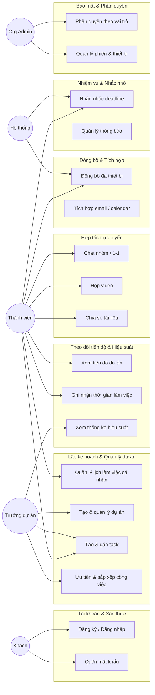

# Tài liệu Phân tích Yêu cầu (SRS)

> **Đề tài 21:** Ứng dụng quản lý và theo dõi làm việc từ xa
> **Nền tảng:** Android native (Kotlin — bắt buộc) · iOS (Swift — mở rộng tùy chọn)
> **Backend:** Java Spring Boot
> **Trạng thái:** Giai đoạn nghiên cứu (Draft v0.1)

---

## 1. Tổng quan dự án

### 1.1 Mục tiêu

Xây dựng ứng dụng mobile giúp cá nhân và nhóm làm việc từ xa có thể:

- Lập kế hoạch, tổ chức và theo dõi công việc (cá nhân + dự án nhóm).
- Đo lường tiến độ và hiệu suất làm việc một cách trực quan.
- Cộng tác trực tuyến (chat, họp video, chia sẻ tài liệu).
- Không bỏ sót deadline nhờ hệ thống nhắc nhở tự động.
- Làm việc liền mạch trên nhiều thiết bị, kể cả khi mất mạng.
- Đảm bảo an toàn dữ liệu và kiểm soát quyền truy cập theo vai trò.

### 1.2 Phạm vi

| Trong phạm vi (In-scope) | Ngoài phạm vi (Out-of-scope) |
|---|---|
| App Android native bằng Kotlin | Bản iOS native (chỉ làm nếu còn thời gian) |
| Backend REST + WebSocket bằng Spring Boot | Web admin portal (có thể làm bản tối giản) |
| 6 nhóm chức năng theo đề tài | Desktop app |
| Push notification qua FCM | AI dự đoán năng suất, billing/thanh toán |
| Video call nhóm (WebRTC hoặc SDK bên thứ ba) | Livestream / ghi hình hội nghị quy mô lớn |

### 1.3 Đối tượng và bối cảnh sử dụng

- Sinh viên, nhóm làm đồ án, startup nhỏ, team làm việc hybrid/remote.
- Người dùng chính thao tác trên **điện thoại Android**; làm việc ở nhiều nơi, mạng không ổn định → cần **offline-first**.

---

## 2. Tác nhân (Actors)

| Mã | Tác nhân | Mô tả | Quyền chính |
|---|---|---|---|
| AC-1 | Khách (Guest) | Chưa đăng nhập | Đăng ký, đăng nhập, quên mật khẩu |
| AC-2 | Thành viên (Member) | Người dùng đã đăng nhập | Quản lý task cá nhân, xem dự án được tham gia, chat, xem báo cáo của mình |
| AC-3 | Trưởng dự án (Project Manager / Owner) | Người tạo/quản lý dự án | Thêm/xóa thành viên, tạo & gán task, xem báo cáo dự án, cấu hình nhắc nhở |
| AC-4 | Quản trị tổ chức (Org Admin) | Quản lý workspace/tổ chức | Quản lý thành viên tổ chức, quyền truy cập, audit log, cấu hình chung |
| AC-5 | Hệ thống (System) | Tiến trình nền | Gửi nhắc deadline, push notification, đồng bộ dữ liệu, tính thống kê |

---

## 3. Sơ đồ Use Case tổng quát

---

## 4. Danh sách yêu cầu chức năng (Functional Requirements)

**Thang ưu tiên MoSCoW:** `M` = Must (bắt buộc cho MVP) · `S` = Should · `C` = Could · `W` = Won't (giai đoạn này)

### 4.A. Tài khoản & Xác thực (nền tảng)

| Mã | Chức năng | Tác nhân | Ưu tiên |
|---|---|---|---|
| FR-A01 | Đăng ký tài khoản bằng email/mật khẩu, xác thực email | Guest | M |
| FR-A02 | Đăng nhập (email + Google Sign-In) | Guest | M |
| FR-A03 | Quên / đặt lại mật khẩu qua email | Guest | M |
| FR-A04 | Xem & cập nhật hồ sơ (tên, avatar, chức danh, múi giờ) | Member | M |
| FR-A05 | Đăng xuất, quản lý phiên trên nhiều thiết bị, thu hồi phiên | Member | S |
| FR-A06 | Xác thực 2 lớp (2FA qua OTP/email) | Member | C |

### 4.B. Lập kế hoạch & Quản lý dự án (nhóm 1)

| Mã | Chức năng | Tác nhân | Ưu tiên |
|---|---|---|---|
| FR-B01 | Tạo & quản lý **lịch làm việc cá nhân** (ngày/tuần/tháng) | Member | M |
| FR-B02 | Tạo, sửa, lưu trữ, xóa **dự án** | PM | M |
| FR-B03 | Mời / thêm / xóa thành viên dự án (qua email hoặc link mời) | PM | M |
| FR-B04 | Tạo & quản lý **task**: tiêu đề, mô tả, deadline, trạng thái, độ ưu tiên, nhãn, checklist/subtask | Member/PM | M |
| FR-B05 | **Gán task** cho một hoặc nhiều thành viên | PM | M |
| FR-B06 | **Ưu tiên & sắp xếp** công việc (priority levels, sort, filter) | Member/PM | M |
| FR-B07 | Nhiều chế độ xem: Kanban board, danh sách, timeline/lịch | Member | M |
| FR-B08 | Phụ thuộc giữa các task (task A chặn task B) | PM | C |
| FR-B09 | Bình luận, @mention, đính kèm file trong task | Member | S |
| FR-B10 | Template dự án/kế hoạch tái sử dụng | PM | C |

### 4.C. Theo dõi tiến độ & Hiệu suất (nhóm 2)

| Mã | Chức năng | Tác nhân | Ưu tiên |
|---|---|---|---|
| FR-C01 | **Dashboard tiến độ dự án**: % hoàn thành, số task theo trạng thái | Member/PM | M |
| FR-C02 | Theo dõi tiến độ **task cá nhân** (hôm nay, quá hạn, sắp tới) | Member | M |
| FR-C03 | **Ghi nhận thời gian làm việc** (timer start/stop + nhập thủ công) | Member | S |
| FR-C04 | **Thống kê năng suất**: số task hoàn thành theo ngày/tuần/tháng | Member/PM | S |
| FR-C05 | Báo cáo hiệu suất theo thành viên / theo dự án | PM | S |
| FR-C06 | Biểu đồ burndown / velocity | PM | C |

### 4.D. Hợp tác trực tuyến (nhóm 3)

| Mã | Chức năng | Tác nhân | Ưu tiên |
|---|---|---|---|
| FR-D01 | **Workspace ảo** theo dự án/nhóm (không gian làm việc chung) | PM/Admin | S |
| FR-D02 | **Chat nhóm** theo dự án và chat 1-1 | Member | M |
| FR-D03 | Chat **realtime**: gửi text, ảnh/file, emoji, trả lời (reply) | Member | M |
| FR-D04 | Trạng thái online/offline, đang gõ (typing), đã đọc | Member | S |
| FR-D05 | **Họp video nhóm** (tạo phòng, mời thành viên, tham gia) | Member | S |
| FR-D06 | Chia sẻ màn hình trong cuộc họp | Member | C |
| FR-D07 | **Chia sẻ tài liệu**: upload/download, phân quyền xem/sửa | Member | S |
| FR-D08 | Thông báo khi được mention hoặc có tin nhắn mới | Member | S |

### 4.E. Quản lý nhiệm vụ & Nhắc nhở (nhóm 4)

| Mã | Chức năng | Tác nhân | Ưu tiên |
|---|---|---|---|
| FR-E01 | **Nhắc deadline tự động** (trước N giờ/ngày, và khi quá hạn) | System | M |
| FR-E02 | **Push notification** qua Firebase Cloud Messaging | System | M |
| FR-E03 | **Trung tâm thông báo trong app** (đánh dấu đã đọc, xóa) | Member | M |
| FR-E04 | Thông báo khi được **gán task** / bị thay đổi deadline | System | M |
| FR-E05 | Cấu hình **tùy chọn nhắc nhở cá nhân** (bật/tắt, thời điểm) | Member | S |
| FR-E06 | Nhắc nhở task quá hạn / cần cập nhật tiến độ | System | S |

### 4.F. Đồng bộ dữ liệu & Tích hợp ứng dụng (nhóm 5)

| Mã | Chức năng | Tác nhân | Ưu tiên |
|---|---|---|---|
| FR-F01 | **Đồng bộ dữ liệu đa thiết bị** (điện thoại ↔ máy tính/máy khác) realtime | System | M |
| FR-F02 | **Chế độ offline** + tự động đồng bộ khi có mạng trở lại | System | M |
| FR-F03 | **Tích hợp email**: gửi lời mời, thông báo, nhắc nhở qua email | System | S |
| FR-F04 | **Tích hợp Calendar**: đồng bộ task/deadline lên Google Calendar, export .ics | System | S |
| FR-F05 | Import/Export dữ liệu (CSV/JSON) | PM | C |
| FR-F06 | Public API / Webhook mở để tích hợp công cụ khác | System | W |

### 4.G. Bảo mật & Quản lý quyền truy cập (nhóm 6)

| Mã | Chức năng | Tác nhân | Ưu tiên |
|---|---|---|---|
| FR-G01 | **Phân quyền theo vai trò (RBAC)**: Owner / Admin / Member / Viewer | Admin | M |
| FR-G02 | Quyền chi tiết trên từng dự án & tài liệu | PM/Admin | S |
| FR-G03 | **Mã hóa dữ liệu**: TLS khi truyền, hash mật khẩu (BCrypt/Argon2), mã hóa tệp nhạy cảm | System | M |
| FR-G04 | **JWT + refresh token**, hết hạn & thu hồi phiên | System | M |
| FR-G05 | **Audit log** các hành động quan trọng | Admin | S |
| FR-G06 | Chia sẻ link có mật khẩu / thời hạn | Member | C |

---

## 5. Đặc tả Use Case chi tiết (chọn lọc)

### UC-01 · Đăng nhập
- **Tác nhân:** Khách | **Ưu tiên:** Must
- **Tiền điều kiện:** Có tài khoản đã kích hoạt.
- **Luồng chính:**
  1. Người dùng mở app → màn hình đăng nhập.
  2. Nhập email + mật khẩu (hoặc chọn Google Sign-In).
  3. App gửi yêu cầu tới `POST /api/v1/auth/login`.
  4. Backend kiểm tra, phát hành access token (ngắn hạn) + refresh token (dài hạn).
  5. App lưu token an toàn (EncryptedSharedPreferences/DataStore), chuyển tới màn hình chính.
- **Luồng thay thế:**
  - 3a. Sai thông tin → hiển thị lỗi, không tiết lộ email tồn tại hay không.
  - 3b. Tài khoản bị khóa → thông báo liên hệ admin.
- **Hậu điều kiện:** Phiên đăng nhập được tạo, người dùng vào được workspace.

### UC-02 · Tạo dự án và mời thành viên
- **Tác nhân:** Trưởng dự án
- **Luồng chính:** Tạo dự án (tên, mô tả, ngày bắt đầu/kết thúc) → thêm thành viên bằng email → hệ thống gửi lời mời qua email + push → thành viên chấp nhận → xuất hiện trong danh sách thành viên.
- **Luồng thay thế:** Email không tồn tại → báo lỗi; người được mời đã là thành viên → bỏ qua, thông báo.
- **Hậu điều kiện:** Dự án có danh sách thành viên, mỗi người có vai trò.

### UC-03 · Tạo & gán task
- **Tác nhân:** Member/PM
- **Luồng chính:** Chọn dự án → tạo task (tiêu đề, mô tả, deadline, ưu tiên, nhãn) → gán cho thành viên → hệ thống tạo thông báo cho người được gán và ghi audit log → task hiển thị trên board.
- **Luồng thay thế:** Deadline trong quá khứ → cảnh báo; không có quyền → từ chối.
- **Hậu điều kiện:** Task được lưu, người được gán nhận push.

### UC-04 · Nhắc nhở deadline (tự động)
- **Tác nhân:** Hệ thống (scheduler)
- **Luồng chính:** Scheduler chạy định kỳ → quét task/event tới hạn theo ngưỡng cấu hình → tạo bản ghi thông báo → gửi push FCM (và email nếu bật) tới người liên quan → ghi log.
- **Luồng thay thế:** Thiết bị offline → thông báo lưu trong trung tâm thông báo, hiển thị khi mở app.
- **Hậu điều kiện:** Người dùng nhận nhắc nhở đúng thời điểm.

### UC-05 · Chat nhóm realtime
- **Tác nhân:** Member
- **Luồng chính:** Mở kênh chat của dự án → kết nối WebSocket (STOMP topic theo dự án) → gửi tin nhắn → lưu DB → broadcast tới mọi thành viên online → member offline nhận push.
- **Luồng thay thế:** Mất kết nối → hiển thị tin ở trạng thái "đang gửi", retry khi có mạng.
- **Hậu điều kiện:** Tin nhắn xuất hiện ở tất cả client gần như tức thời.

### UC-06 · Bắt đầu cuộc họp video
- **Tác nhân:** Member/PM
- **Luồng chính:** Tạo phòng họp → hệ thống sinh `roomId` → hiển thị link/lời mời → thành viên tham gia → backend đóng vai trò signaling → các peer thiết lập kết nối WebRTC → cuộc họp diễn ra.
- **Luồng thay thế:** NAT khó → dùng TURN server; quá số người → từ chối.
- **Hậu điều kiện:** Cuộc họp kết thúc, ghi log thời lượng (nếu cần).

### UC-07 · Ghi nhận thời gian làm việc
- **Tác nhân:** Member
- **Luồng chính:** Mở task → bấm Start timer → app ghi `startTime` (offline vẫn chạy) → bấm Stop → tạo `time_entry` → đồng bộ lên server → cộng vào thống kê.
- **Luồng thay thế:** Quên stop → cảnh báo khi mở lại app; cho phép sửa log thủ công.

---

## 6. User Stories & Tiêu chí chấp nhận (mẫu)

**US-01 (Nhóm 1 — Quản lý dự án)**
> Là **trưởng dự án**, tôi muốn **tạo task và gán cho thành viên kèm deadline** để **phân công công việc rõ ràng**.

*Acceptance Criteria:*
- [ ] Tạo được task với tiêu đề bắt buộc, deadline tùy chọn.
- [ ] Chọn được ≥ 1 thành viên dự án để gán.
- [ ] Thành viên được gán nhận push notification trong vòng vài giây.
- [ ] Task hiển thị đúng cột trạng thái trên Kanban board.
- [ ] Hoạt động được khi offline và đồng bộ khi có mạng.

**US-02 (Nhóm 2 — Theo dõi)**
> Là **thành viên**, tôi muốn **xem thống kê số task hoàn thành theo tuần** để **biết mình có đang đúng tiến độ không**.

*Acceptance Criteria:*
- [ ] Biểu đồ hiển thị số task hoàn thành theo ngày trong tuần.
- [ ] Số liệu khớp với dữ liệu task thực tế.
- [ ] Lọc được theo dự án.

**US-03 (Nhóm 4 — Nhắc nhở)**
> Là **thành viên**, tôi muốn **được nhắc trước deadline 1 ngày và 1 giờ** để **không trễ hạn**.

*Acceptance Criteria:*
- [ ] Nhận push ở 2 mốc cấu hình.
- [ ] Có thể tùy chỉnh ngưỡng nhắc trong cài đặt.
- [ ] Không gửi trùng lặp cùng một task cùng mốc.
- [ ] Thông báo lưu lại trong trung tâm thông báo.

**US-04 (Nhóm 6 — Bảo mật)**
> Là **quản trị tổ chức**, tôi muốn **giới hạn quyền của Viewer chỉ được xem** để **bảo vệ dữ liệu dự án**.

*Acceptance Criteria:*
- [ ] Viewer không tạo/sửa/xóa task (API trả 403, UI ẩn nút).
- [ ] Phân quyền thực thi ở tầng backend, không chỉ UI.
- [ ] Thay đổi vai trò có hiệu lực ngay với phiên mới.

---

## 7. Yêu cầu phi chức năng (NFR)

| Nhóm | Mã | Yêu cầu |
|---|---|---|
| Hiệu năng | NFR-P01 | API thông thường phản hồi p95 < 300ms |
| | NFR-P02 | App cold start < 2s trên thiết bị tầm trung |
| | NFR-P03 | Độ trễ chat realtime < 1s trong cùng mạng |
| | NFR-P04 | Danh sách task hỗ trợ phân trang, tải > 1000 task không giật |
| Độ tin cậy | NFR-R01 | Không mất dữ liệu người dùng đã nhập (kể cả offline) |
| | NFR-R02 | Đồng bộ idempotent, tránh tạo dữ liệu trùng |
| Offline | NFR-O01 | Xem & thao tác task/chat ở chế độ offline, tự đồng bộ khi có mạng |
| Bảo mật | NFR-S01 | Toàn bộ kết nối dùng HTTPS/WSS (TLS 1.2+) |
| | NFR-S02 | Mật khẩu hash bằng BCrypt/Argon2, không lưu plaintext |
| | NFR-S03 | Token lưu trong EncryptedSharedPreferences/Keystore |
| | NFR-S04 | Chống OWASP Mobile Top 10 cơ bản (insecure storage, improper auth...) |
| | NFR-S05 | Rate limit các endpoint nhạy cảm (login, gửi OTP) |
| Khả năng mở rộng | NFR-E01 | Backend stateless, scale ngang được |
| | NFR-E02 | Tách module rõ ràng để dễ mở rộng tính năng |
| Khả dụng/UX | NFR-U01 | Material Design 3, hỗ trợ dark mode |
| | NFR-U02 | Giao diện tiếng Việt (có thể mở rộng i18n) |
| | NFR-U03 | Thao tác chính tối đa 3 lần chạm |
| Tương thích | NFR-C01 | Android 8.0 (API 26) trở lên, target API mới nhất |
| | NFR-C02 | Hoạt động trên màn hình từ 5" đến tablet |
| Bảo trì | NFR-M01 | Code theo Clean Architecture, có test cho tầng domain/data |
| | NFR-M02 | Tài liệu API tự sinh (OpenAPI/Swagger) |

---

## 8. Ràng buộc & Giả định

**Ràng buộc**
- Mobile chính là **Kotlin Android native** (theo yêu cầu môn học); bản iOS chỉ làm nếu còn thời gian.
- Backend dùng **Java Spring Boot**.
- Nguồn lực hạn chế (nhóm nhỏ/sinh viên) → ưu tiên MVP chạy được end-to-end.
- Video call quy mô nhỏ (2–8 người) để không cần hạ tầng SFU lớn.

**Giả định**
- Người dùng có kết nối Internet gián đoạn (không phải lúc nào cũng online).
- Không xử lý thanh toán hay dữ liệu đặc biệt nhạy cảm (y tế/tài chính).
- Máy chủ triển khai: VPS hoặc nền tảng cloud miễn phí/rẻ cho mục đích demo.

---

## 9. Truy vết yêu cầu → Nhóm chức năng đề tài

| Nhóm chức năng (đề tài) | Yêu cầu tương ứng |
|---|---|
| Lập kế hoạch & Quản lý dự án | FR-B01 → FR-B10, FR-A01 → FR-A04 |
| Theo dõi tiến độ & Hiệu suất | FR-C01 → FR-C06 |
| Hợp tác trực tuyến & Giao tiếp | FR-D01 → FR-D08 |
| Quản lý nhiệm vụ & Thông báo | FR-E01 → FR-E06 |
| Đồng bộ & Tích hợp ứng dụng | FR-F01 → FR-F06 |
| Bảo mật & Quản lý quyền truy cập | FR-G01 → FR-G06 |

> Bảng ánh xạ chi tiết yêu cầu → giai đoạn triển khai xem tại `03-roadmap-va-mvp.md`.
