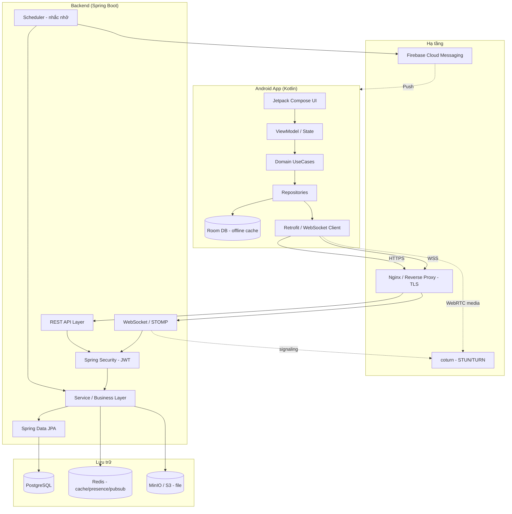
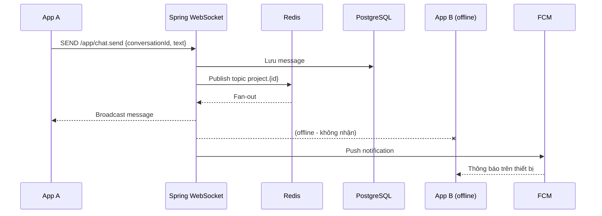
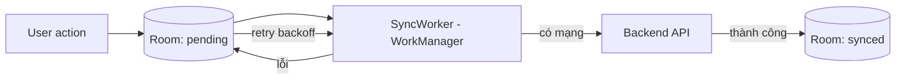
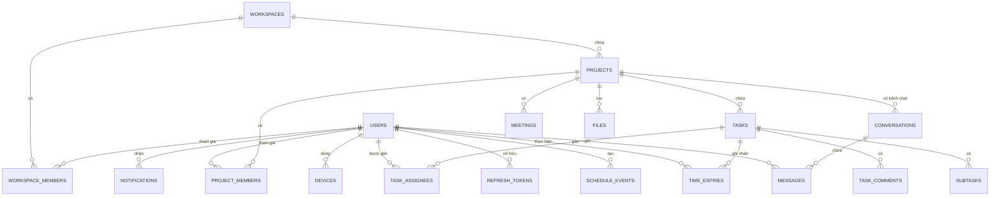
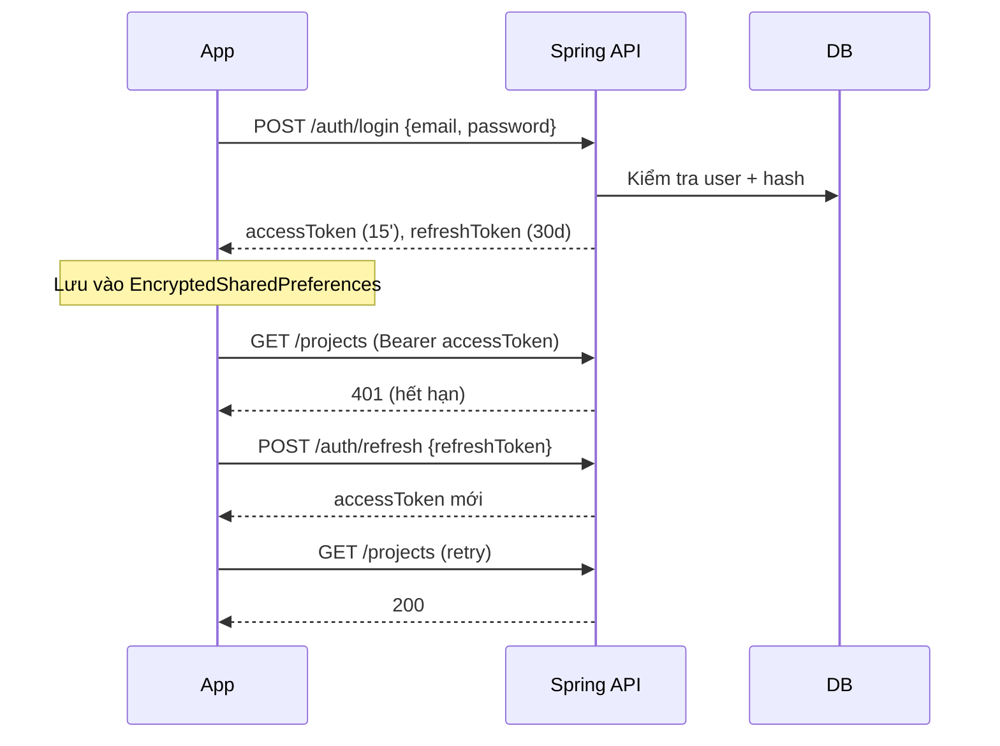
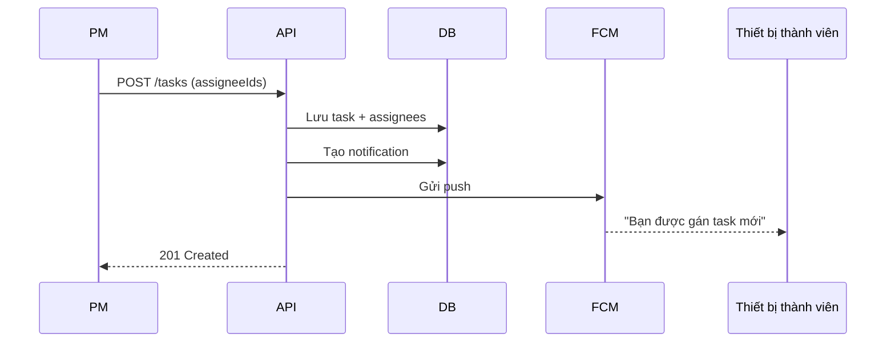
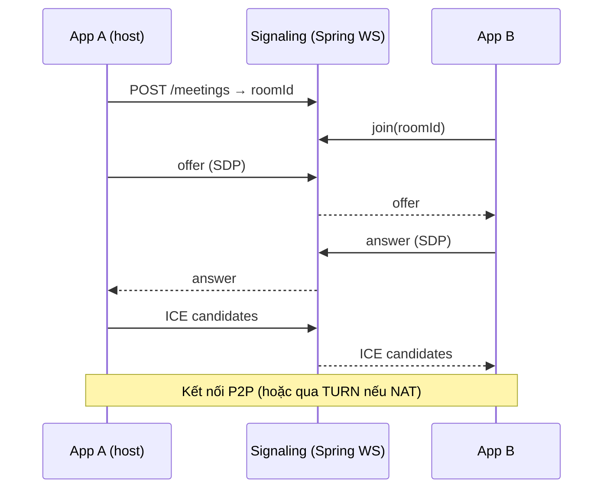
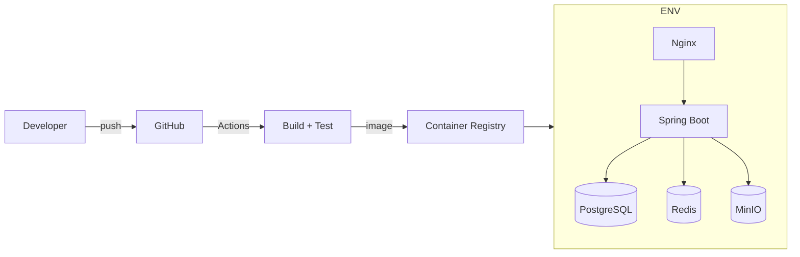

# Tài liệu Kiến trúc & Tech Stack

> Đề tài 21 — Ứng dụng quản lý và theo dõi làm việc từ xa
> Android (Kotlin) · Spring Boot · PostgreSQL

---

## 1. Kiến trúc tổng thể

Mô hình **Client–Server** hướng dịch vụ, giao tiếp qua **REST (HTTP/JSON)** cho nghiệp vụ và **WebSocket** cho realtime.



**Nguyên tắc chính**
- **Offline-first:** Room DB là nguồn dữ liệu cục bộ, app vẫn dùng được khi mất mạng; đồng bộ nền bằng WorkManager.
- **Stateless backend:** JWT giúp mở rộng ngang dễ dàng; trạng thái realtime đẩy vào Redis.
- **Tách tầng rõ ràng:** UI không gọi trực tiếp API; đi qua domain/use-case.
- **Realtime hai kênh:** WebSocket cho chat/presence, FCM cho push khi app ở nền.

---

## 2. Tech Stack

### 2.1 Android (Kotlin, bắt buộc)

| Thành phần | Lựa chọn | Ghi chú |
|---|---|---|
| Ngôn ngữ | Kotlin 2.x | Coroutines + Flow |
| UI | **Jetpack Compose** + Material 3 | Khai báo, hỗ trợ dark mode |
| Điều hướng | Navigation Compose | Type-safe routes |
| Kiến trúc | MVVM + Clean Architecture | presentation / domain / data |
| DI | **Hilt** | Chuẩn Google, dễ test |
| Bất đồng bộ | Coroutines + Flow/StateFlow | |
| Mạng REST | Retrofit + OkHttp + Kotlinx Serialization | Interceptor gắn JWT, refresh token |
| Realtime | OkHttp WebSocket (hoặc Scarlet) | STOMP over WS |
| Local DB | **Room** | Offline cache, Single Source of Truth |
| Preferences | DataStore + EncryptedSharedPreferences | Lưu token bảo mật |
| Background | **WorkManager** | Đồng bộ định kỳ, retry |
| Push | Firebase Cloud Messaging | |
| Ảnh | Coil | Load avatar/attachment |
| Phân trang | Paging 3 | Danh sách task/tin nhắn dài |
| Video call | `stream-webrtc-android` (WebRTC) **hoặc** Agora/Jitsi SDK | Xem mục 12 – ADR |
| Media | AndroidX Media3 | Ghi âm/phát lại nếu cần |
| Test | JUnit5, MockK, Turbine, Compose UI Test, Espresso | |

### 2.2 Backend (Java Spring Boot)

| Thành phần | Lựa chọn |
|---|---|
| Ngôn ngữ / JDK | Java 21 (LTS) |
| Framework | Spring Boot 3.3+ |
| Web REST | Spring Web MVC |
| Bảo mật | Spring Security + JWT (jjwt) |
| Realtime | Spring WebSocket (STOMP) + Redis Pub/Sub |
| ORM | Spring Data JPA / Hibernate |
| CSDL | PostgreSQL 16 |
| Migration | Flyway |
| Cache / Presence | Redis |
| Lưu file | MinIO (tương thích S3) |
| Lập lịch | Spring `@Scheduled` (hoặc Quartz nếu cần cron phức tạp) |
| Email | Spring Mail (SMTP) |
| API Docs | springdoc-openapi (Swagger UI) |
| Mapping | MapStruct + Lombok |
| Validation | Jakarta Bean Validation |
| Observability | Actuator + Micrometer/Prometheus |
| Test | JUnit5, Mockito, Testcontainers (PostgreSQL/Redis) |
| Build | Gradle (Kotlin DSL) |

### 2.3 Hạ tầng & DevOps

| Thành phần | Lựa chọn |
|---|---|
| Container | Docker + Docker Compose |
| Reverse proxy | Nginx (TLS termination) |
| CI/CD | GitHub Actions (build, test, lint) |
| Triển khai | VPS / Render / Railway / Fly.io (demo) |
| Chất lượng code | ktlint/detekt (Android), Spotless/Checkstyle (Java) |

---

## 3. Kiến trúc Android App

### 3.1 Mô hình Clean Architecture

```
┌─────────────────────────────────────────────┐
│ presentation/   Compose Screens, ViewModel   │  ← UI
├─────────────────────────────────────────────┤
│ domain/         UseCase, Model, Repository   │  ← nghiệp vụ thuần Kotlin
├─────────────────────────────────────────────┤
│ data/           Repository Impl, Api, Dao     │  ← Retrofit, Room, WS
└─────────────────────────────────────────────┘
```

- **UI (Compose)** chỉ quan sát `StateFlow<UiState>` từ ViewModel.
- **ViewModel** gọi **UseCase**, không biết đến Retrofit/Room.
- **Repository** quyết định lấy từ Room (local) hay Api (remote) → chiến lược *local-first, sync nền*.

### 3.2 Cấu trúc thư mục đề xuất

```
app/
 ├─ src/main/java/com/example/remoteapp/
 │   ├─ MyApplication.kt
 │   ├─ di/                       # Hilt modules
 │   ├─ core/
 │   │   ├─ network/              # Retrofit, interceptors, ApiResult
 │   │   ├─ database/             # Room DB, DAO, converters
 │   │   ├─ datastore/            # Token, cài đặt người dùng
 │   │   ├─ realtime/             # WebSocket client, event bus
 │   │   ├─ notification/         # FCM service, channel
 │   │   ├─ sync/                 # SyncManager, WorkManager workers
 │   │   └─ common/               # utils, extensions, constants
 │   ├─ feature/
 │   │   ├─ auth/                 # login, register, forgot
 │   │   ├─ project/              # list, detail, member
 │   │   ├─ task/                 # board, editor, detail
 │   │   ├─ schedule/             # lịch cá nhân
 │   │   ├─ dashboard/            # tiến độ + thống kê
 │   │   ├─ chat/                 # conversation, message
 │   │   ├─ meeting/              # video call
 │   │   ├─ file/                 # tài liệu
 │   │   ├─ notification/         # trung tâm thông báo
 │   │   └─ profile/              # hồ sơ, cài đặt
 │   └─ navigation/               # NavGraph, routes
 └─ src/test, src/androidTest
```

Mỗi `feature/` chia 3 lớp con: `presentation/`, `domain/`, `data/`.
Với đồ án, có thể bắt đầu **single-module** rồi tách multi-module (`:core:network`, `:feature:task`...) nếu cần.

### 3.3 Luồng dữ liệu một chiều (UDF)

`Screen → ViewModel (intent) → UseCase → Repository → (Room ⇄ API) → Flow → UiState → Recompose`

---

## 4. Kiến trúc Backend

### 4.1 Cấu trúc package (theo feature, khuyến nghị)

```
com.example.remoteapp
 ├─ config/            # Security, WebSocket, Redis, OpenAPI, Jackson
 ├─ common/            # exception, response wrapper, utils, base entity
 ├─ auth/              # controller, service, jwt, dto
 ├─ user/              # profile, device, session
 ├─ workspace/         # organization, member, role
 ├─ project/           # project, member, invitation
 ├─ task/              # task, subtask, comment, attachment, label
 ├─ schedule/          # personal event, calendar sync
 ├─ tracking/          # time_entry, productivity stats
 ├─ chat/              # conversation, message, presence
 ├─ meeting/           # room, signaling, participant
 ├─ file/              # upload, metadata, permission
 ├─ notification/      # notification, device token, fcm sender
 └─ integration/       # email, google calendar
```

Mỗi feature: `controller` → `service` → `repository` → `entity/dto`.

### 4.2 Các module chức năng backend

1. **Auth & Security** — đăng ký/đăng nhập, JWT access/refresh, RBAC.
2. **Workspace & Project** — tổ chức, dự án, thành viên, lời mời.
3. **Task** — CRUD task, gán, trạng thái, nhãn, bình luận, phụ thuộc.
4. **Tracking** — time entry, tổng hợp thống kê.
5. **Chat & Presence** — WebSocket STOMP, lưu lịch sử, trạng thái online (Redis).
6. **Meeting signaling** — tạo phòng, trao đổi offer/answer/ICE.
7. **Notification** — tạo thông báo, gửi FCM, lịch nhắc.
8. **File** — upload/download qua MinIO, phân quyền.
9. **Integration** — email (Spring Mail), Google Calendar.

---

## 5. Thiết kế API

### 5.1 Quy ước

- Base path: `/api/v1`
- Xác thực: `Authorization: Bearer <accessToken>`
- Định dạng: JSON; lỗi trả về thống nhất:
```json
{ "timestamp": "2026-01-01T10:00:00Z", "status": 400,
  "code": "TASK_DEADLINE_INVALID", "message": "Deadline không hợp lệ",
  "path": "/api/v1/tasks" }
```
- Phân trang: `?page=0&size=20&sort=createdAt,desc` → trả `content`, `totalElements`, `totalPages`.
- Phiên bản hoá qua URL (`/v1`).

### 5.2 Danh sách endpoint tiêu biểu

| Nhóm | Method & Path | Mô tả |
|---|---|---|
| Auth | `POST /auth/register` · `POST /auth/login` · `POST /auth/refresh` · `POST /auth/logout` | Xác thực |
| Auth | `POST /auth/forgot-password` · `POST /auth/reset-password` | Khôi phục mật khẩu |
| User | `GET /users/me` · `PATCH /users/me` · `GET /users/me/devices` | Hồ sơ & thiết bị |
| Project | `GET/POST /projects` · `GET/PATCH/DELETE /projects/{id}` | Dự án |
| Project | `POST /projects/{id}/members` · `DELETE /projects/{id}/members/{uid}` | Thành viên |
| Task | `GET /projects/{id}/tasks` · `POST /tasks` · `GET/PATCH/DELETE /tasks/{id}` | Task |
| Task | `PATCH /tasks/{id}/status` · `POST /tasks/{id}/assignees` | Trạng thái & gán |
| Task | `POST /tasks/{id}/comments` · `POST /tasks/{id}/attachments` | Bình luận/tệp |
| Schedule | `GET/POST /schedule/events` · `PATCH/DELETE /schedule/events/{id}` | Lịch cá nhân |
| Tracking | `POST /time-entries/start` · `POST /time-entries/stop` · `GET /reports/productivity` | Thời gian & thống kê |
| Chat | `GET /conversations` · `GET /conversations/{id}/messages` | Lịch sử chat |
| Meeting | `POST /meetings` · `POST /meetings/{id}/join` | Phòng họp |
| File | `POST /files` · `GET /files/{id}` | Tải lên/xuống |
| Notification | `GET /notifications` · `PATCH /notifications/{id}/read` · `POST /devices/token` | Thông báo |

### 5.3 WebSocket (STOMP)

- Handshake: `/ws` (JWT qua header/query param).
- Client gửi: `/app/chat.send`, `/app/meeting.signal`, `/app/presence.ping`.
- Client nghe: `/topic/project.{id}` (chat dự án), `/user/queue/notifications`, `/user/queue/presence`.

---

## 6. Realtime & Push



- **Presence** (online/offline/typing) lưu trong Redis với TTL, không ghi DB.
- **Chống mất tin:** tin nhắn luôn lưu DB trước khi broadcast; client offline đồng bộ lại khi online.
- **FCM** chỉ gửi khi user không có kết nối WebSocket hoạt động (kiểm tra presence).

---

## 7. Offline-first & Đồng bộ

**Chiến lược:** Room là nguồn sự thật trên client. Mọi thao tác ghi xuống Room trước, đánh dấu `syncState`, rồi đồng bộ nền.



- **Trạng thái bản ghi:** `SYNCED | PENDING_CREATE | PENDING_UPDATE | PENDING_DELETE | CONFLICT`.
- **Giải quyết xung đột:** *Last-Write-Wins* theo `updatedAt` của server; với dữ liệu quan trọng lưu `version` để phát hiện xung đột, hiển thị cho người dùng khi cần.
- **Đồng bộ pull:** dùng `GET /sync?since=<timestamp>` trả về các thay đổi kể từ lần đồng bộ trước.
- **Kích hoạt:** app mở, có mạng trở lại, định kỳ (WorkManager constraint `NetworkType.CONNECTED`).

---

## 8. Thiết kế Cơ sở dữ liệu

### 8.1 ERD



### 8.2 Bảng chính

| Bảng | Trường tiêu biểu |
|---|---|
| `users` | id, email (unique), password_hash, full_name, avatar_url, job_title, timezone, status, created_at, updated_at |
| `workspaces` | id, name, owner_id, created_at |
| `workspace_members` | workspace_id, user_id, role (OWNER/ADMIN/MEMBER/VIEWER) |
| `projects` | id, workspace_id, name, description, status, start_date, end_date, created_by, archived |
| `project_members` | project_id, user_id, role |
| `tasks` | id, project_id, title, description, status (TODO/DOING/REVIEW/DONE), priority (LOW/MEDIUM/HIGH/URGENT), deadline, parent_task_id, created_by, completed_at, version, created_at, updated_at |
| `task_assignees` | task_id, user_id |
| `task_labels` / `labels` | task_id, label_id / id, project_id, name, color |
| `task_comments` | id, task_id, user_id, content, created_at |
| `attachments` | id, task_id, file_id, uploaded_by |
| `time_entries` | id, task_id, user_id, start_time, end_time, duration_seconds, note |
| `schedule_events` | id, user_id, title, start_time, end_time, type, reminder_offset |
| `conversations` | id, project_id (nullable cho 1-1), type (GROUP/DIRECT), name |
| `conversation_members` | conversation_id, user_id, last_read_message_id |
| `messages` | id, conversation_id, sender_id, content, type (TEXT/IMAGE/FILE), reply_to_id, created_at |
| `message_attachments` | message_id, file_id |
| `meetings` | id, project_id, room_code, host_id, started_at, ended_at, status |
| `files` | id, owner_id, project_id, name, mime_type, size, storage_key, visibility |
| `notifications` | id, user_id, type, title, body, ref_type, ref_id, read_at, created_at |
| `devices` | id, user_id, fcm_token, platform, last_active_at |
| `refresh_tokens` | id, user_id, token_hash, device_id, expires_at, revoked |
| `audit_logs` | id, actor_id, action, entity_type, entity_id, metadata, created_at |

### 8.3 Quy ước chung

- Khóa chính: `BIGSERIAL`/`UUID` (khuyến nghị UUID cho dữ liệu offline để client tự sinh ID).
- Mọi bảng có `created_at`, `updated_at`; bảng nghiệp vụ có `deleted_at` (soft delete) khi cần.
- Đánh index cho `project_id`, `user_id`, `deadline`, `status`, `created_at`.
- Migration quản lý bằng Flyway (`V1__init.sql`, `V2__tasks.sql`...).

---

## 9. Luồng nghiệp vụ quan trọng

### 9.1 Đăng nhập & làm mới token



### 9.2 Gán task → thông báo



### 9.3 Signaling cuộc họp video (WebRTC)



---

## 10. Phân quyền (RBAC)

**Vai trò:** `OWNER > ADMIN > MEMBER > VIEWER`

| Hành động | Owner | Admin | Member | Viewer |
|---|:--:|:--:|:--:|:--:|
| Quản lý workspace & thành viên | ✅ | ✅ | ❌ | ❌ |
| Tạo/xóa dự án | ✅ | ✅ | ❌ | ❌ |
| Thêm/xóa thành viên dự án | ✅ | ✅ | ❌ | ❌ |
| Tạo/sửa/xóa task | ✅ | ✅ | ✅ | ❌ |
| Gán task cho người khác | ✅ | ✅ | ⚠️ | ❌ |
| Bình luận, chat, gửi file | ✅ | ✅ | ✅ | ❌ |
| Xem dự án & báo cáo | ✅ | ✅ | ✅ | ✅ |
| Xem audit log | ✅ | ✅ | ❌ | ❌ |

> ⚠️ = tùy cấu hình dự án. Phân quyền **thực thi ở backend** (method security + kiểm tra ownership), UI chỉ ẩn nút cho đẹp.

**Cơ chế:** Spring Security `@PreAuthorize` kết hợp kiểm tra membership theo `projectId`. JWT chứa `userId`, `workspaceId`, `roles`.

---

## 11. Bảo mật

| Lớp | Biện pháp |
|---|---|
| Truyền tải | HTTPS/WSS (TLS 1.2+), HSTS |
| Mật khẩu | BCrypt (cost ≥ 10) hoặc Argon2 |
| Token | JWT ký HS256/RS256; access ngắn hạn, refresh dài hạn có thể thu hồi |
| Phiên | Lưu refresh token dạng hash; thu hồi khi logout/đổi mật khẩu |
| Client | EncryptedSharedPreferences/Keystore; certificate pinning (tùy chọn) |
| API | Rate limit (Bucket4j/Redis), validate input, chống injection |
| File | Kiểm tra MIME/size, virus scan (tùy chọn), URL có thời hạn |
| Dữ liệu | Backup định kỳ; soft delete; audit log |
| Mobile | Tuân thủ OWASP MASVS cơ bản |

---

## 12. Quyết định kiến trúc (ADR)

| # | Quyết định | Phương án khác | Lý do chọn |
|---|---|---|---|
| ADR-01 | Jetpack Compose cho UI | XML View | Hiện đại, ít boilerplate, dễ áp dụng M3 |
| ADR-02 | Room làm Single Source of Truth | Gọi API trực tiếp | Cần offline-first, UX mượt |
| ADR-03 | WebSocket STOMP | Polling, SSE | Chat 2 chiều, presence, chuẩn Spring hỗ trợ sẵn |
| ADR-04 | PostgreSQL | MySQL | Tính năng mạnh, JSONB, quan hệ tốt |
| ADR-05 | Video: WebRTC tự dựng + coturn | Agora/Jitsi managed | Học thuật, không phụ thuộc phí; có thể đổi sang SDK để giảm rủi ro |
| ADR-06 | UUID cho khoá chính | BIGSERIAL | Client tự sinh ID khi offline, tránh trùng |
| ADR-07 | Đồng bộ Last-Write-Wins | CRDT | Đơn giản, đủ dùng cho đồ án |

> **Lưu ý rủi ro:** WebRTC tự dựng tốn công (NAT/TURN, nhiều thiết bị test). Nếu thời gian gấp, chuyển sang **Jitsi Meet SDK** hoặc **Agora** cho phần video — vẫn đảm bảo chức năng "họp video nhóm".

---

## 13. Hạ tầng & Môi trường



- **Môi trường:** `local` (docker-compose), `staging`, `production`.
- **Biến cấu hình:** dùng `.env`/Spring profile; không commit secret.
- **Chất lượng:** ktlint/detekt cho Android, Spotless cho Java; CI chạy test + lint mỗi PR.
- **Quan sát:** Actuator health/metrics; log tập trung (tùy chọn Loki/ELK).
