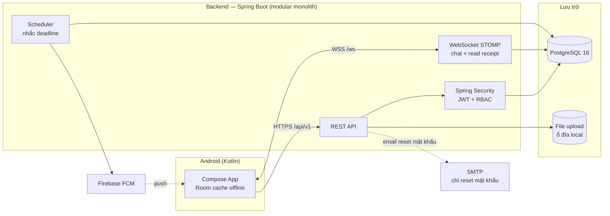
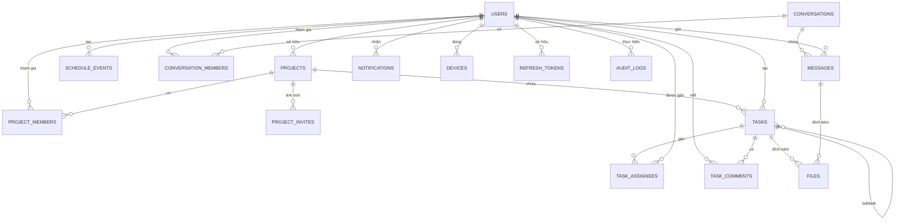

# Tài liệu Thiết kế Backend (phiên bản đơn giản hoá)

> **Đề tài 21:** Ứng dụng quản lý và theo dõi làm việc từ xa
> **Phiên bản:** v0.2 — cập nhật theo góp ý người hướng dẫn: *ứng dụng đang ôm quá nhiều chức năng; giữ các chức năng "nên có của một ứng dụng di động", cắt các chức năng "đậm chất desktop"*.
> Tài liệu này **cập nhật phạm vi** của `01-phan-tich-yeu-cau.md` và **thay thế phần kiến trúc backend** của `02-kien-truc-va-tech-stack.md`. `03-roadmap-va-mvp.md` vẫn đúng về thứ tự giai đoạn.

---

## 1. Phạm vi sau rà soát (giữ / cắt)

### 1.1 Giữ trong phạm vi backend

| Nhóm | Chức năng | Ghi chú |
|---|---|---|
| A | A01 Đăng ký email/mật khẩu | |
| A | A02 Đăng nhập email + mật khẩu | Google Sign-In để sau |
| A | A03 Quên / đặt lại mật khẩu | Rút gọn: nhập email → nhận link đặt lại mật khẩu |
| A | A04 Hồ sơ (tên, avatar) | Bỏ chức danh, múi giờ |
| B | B01 Lịch làm việc cá nhân | Sự kiện cá nhân + hiển thị deadline task |
| B | B02 CRUD dự án | Tạo/sửa/xóa dự án (tên, mô tả) |
| B | B03 Mời thành viên | **Rút gọn: chỉ còn link mời** (sinh mã link, không gửi email mời) |
| B | B04 Task: tiêu đề, mô tả, deadline, trạng thái, ưu tiên, nhãn, checklist | |
| B | B05 Gán task cho nhiều thành viên | |
| B | B07 Kanban + danh sách + **timeline** | Timeline cần `start_date` + `deadline` của task |
| B | B09 Bình luận, @mention, đính kèm file trong task | Kênh trao đổi chính của nhóm |
| C | C01 Dashboard tiến độ dự án | Rút gọn: % hoàn thành, số task theo trạng thái, quá hạn |
| C | C02 "Hôm nay" của tôi | Điểm khác biệt: task đến hạn / quá hạn / sắp tới gộp một màn |
| C | C04 Thống kê năng suất cá nhân | Đơn giản: số task hoàn thành theo ngày/tuần/tháng |
| C | C05 Báo cáo dự án theo thành viên | Rút gọn: chỉ % hoàn thành + số task |
| D | D02 Chat nhóm theo dự án + chat 1-1 | **Chức năng cốt lõi** |
| D | D03 Chat realtime: text, ảnh/file, trả lời (reply) | Emoji dùng như ký tự text |
| D | D04 Đã đọc (read receipt) | Cắt typing, cắt trạng thái online/offline |
| D | D07 Đính kèm tài liệu | Rút gọn: upload/download file gắn vào task (không phân quyền theo tài liệu) |
| D | D08 Thông báo khi được mention | |
| E | E01 Nhắc deadline tự động | Mốc **cố định**: trước 1 ngày, trước 1 giờ, khi quá hạn |
| E | E02 Push notification (FCM) | |
| E | E03 Trung tâm thông báo (đã đọc / chưa đọc) | |
| E | E04 Thông báo khi được gán task | **Bản tối giản**: chỉ push khi được gán task, không có thông báo đổi deadline |
| E | E06 Nhắc task quá hạn | |
| F | F01 Đồng bộ đa thiết bị | Mặc nhiên có — dữ liệu tập trung trên server, không cần cơ chế riêng |
| F | F03 Email | Rút gọn: **chỉ** gửi email quên mật khẩu |
| G | G01 RBAC 3 vai trò | Owner / Member / Viewer, theo từng dự án |
| G | G03 Mã hóa TLS + hash mật khẩu | |
| G | G04 JWT + refresh token, thu hồi phiên | |
| G | G05 **Audit log** | Giữ: ghi các hành động quan trọng, Owner xem được |

### 1.2 Cắt / để sau (không làm trong kỳ này)

| Mã | Chức năng | Lý do cắt |
|---|---|---|
| A05 | Quản lý phiên đa thiết bị, thu hồi phiên | Đủ dùng với logout + thu hồi refresh token |
| A06 | 2FA | Không cần cho đồ án |
| B06 | Sort / filter nâng cao | **Client tự xử lý** — backend trả đủ dữ liệu |
| B08 | Phụ thuộc giữa các task | Đặc trưng công cụ desktop (Jira, MS Project) |
| B10 | Template dự án | Đặc trưng desktop |
| C03 | Timer ghi nhận thời gian | Cắt để tập trung vào lõi quản lý công việc |
| C06 | Burndown / velocity | Đặc trưng desktop/scrum |
| D01 | Workspace / tổ chức | Dự án là cấp cao nhất — đủ cho nhóm nhỏ |
| D05 | Họp video | Không xây signaling WebRTC; nếu cần họp thì **tạo phòng Zoom/Jitsi/Meet và gửi link vào chat** |
| D06 | Chia sẻ màn hình | Thuần desktop |
| E05 | Cấu hình mốc nhắc cá nhân | Mốc nhắc cố định là đủ |
| F02 | Đồng bộ offline 2 chiều (`GET /sync?since=`, hàng đợi đồng bộ, xử lý xung đột) | **Bỏ luôn** — gần như không cần; mobile chỉ cache read-only để xem lịch & deadline khi mất mạng |
| F04 | Tích hợp Google Calendar / .ics | Để sau |
| F05 | Import/Export CSV/JSON | Thuần desktop |
| F06 | Public API / Webhook | Ngoài phạm vi |
| G02 | Quyền chi tiết theo từng tài liệu | Quá nặng cho nhóm nhỏ |
| G06 | Link chia sẻ có mật khẩu / thời hạn | Để sau |

### 1.3 Các điểm chỉnh sửa so với tài liệu ban đầu

1. **Bỏ tầng workspace/organization và vai trò Org Admin** (AC-4, bảng `workspaces`): mô hình chỉ còn `users → project_members → projects`. Phù hợp "nhóm nhỏ, sinh viên".
2. **B06 chuyển xuống client:** API `GET /projects/{id}/tasks` trả toàn bộ task của dự án (nhóm nhỏ), client tự sort/filter — backend không cần tham số lọc phức tạp.
3. **B07 giữ timeline** → bảng `tasks` **thêm trường `start_date`** (docs ban đầu chỉ có `deadline`).
4. **Chat là chức năng cốt lõi** (D02/D03), gồm cả chat 1-1 và read receipt; **cắt typing + presence** → không cần Redis cho presence.
5. **Video = link phòng họp bên thứ 3 gửi trong chat** (D05): backend không có module `meeting`, không cần coturn/TURN.
6. **E04 giữ bản tối giản** (push khi được gán task); **E05 cắt** → mốc nhắc cố định, không có bảng cấu hình nhắc.
7. **Audit log giữ lại** (G05) — ghi hành động quan trọng, Owner xem được.
8. **Hạ tầng đơn giản hoá:** bỏ **Redis** (không presence, không cache bắt buộc — broker WebSocket chạy in-memory cho demo; nếu scale ngang mới thêm Redis Pub/Sub), bỏ **MinIO** (file lưu đĩa local + metadata trong PostgreSQL; nếu cần object storage thật thì thay bằng MinIO/S3 sau mà không đổi API).
9. **Bỏ MapStruct:** dùng Java `record` cho DTO, mapping thủ công (đủ dùng, ít magic code). Giữ Lombok cho entity.
10. **Email thuần túy:** Spring Mail chỉ dùng cho quên mật khẩu (không gửi lời mời — lời mời qua link).
11. **Bỏ cơ chế đồng bộ offline (F02):** không `GET /sync?since=`, không hàng đợi đồng bộ, không xử lý xung đột. Mobile tự cache read-only (Room) để **xem** lịch & deadline khi mất mạng; thao tác ghi cần có mạng.

---

## 2. Kiến trúc tổng thể



**Nguyên tắc**
- **Modular monolith**, chia package theo feature — không vi mô dịch vụ.
- **Stateless:** JWT, không lưu session server; mở rộng ngang được nếu cần.
- **Offline ở mức xem:** client cache read-only (Room) để xem lịch & deadline khi mất mạng; thao tác ghi cần có mạng — không xây đồng bộ 2 chiều.
- **Realtime 2 kênh:** WebSocket khi app mở, FCM khi app nền/offline.

---

## 3. Tech Stack (backend)

| Thành phần | Lựa chọn | Ghi chú |
|---|---|---|
| Ngôn ngữ / JDK | Java 21 (LTS) | |
| Framework | Spring Boot 3.3+ | Spring Web MVC |
| Bảo mật | Spring Security + JWT (jjwt) | Access 15' + Refresh 30 ngày |
| Realtime | Spring WebSocket (STOMP) | Broker in-memory cho demo |
| ORM | Spring Data JPA / Hibernate | |
| CSDL | PostgreSQL 16 | |
| Migration | Flyway | `V1__init.sql`, `V2__*.sql`… |
| File | Ổ đĩa local (`uploads/`) + bảng `files` | Interface `StorageService` để thay MinIO/S3 sau |
| Push | firebase-admin SDK | |
| Email | Spring Mail (SMTP) | Chỉ quên mật khẩu |
| Lập lịch | Spring `@Scheduled` | Quét deadline |
| API docs | springdoc-openapi (Swagger UI) | |
| DTO / mapping | Java `record`, mapping thủ công | Bỏ MapStruct |
| Validation | Jakarta Bean Validation | |
| Test | JUnit5, Mockito, Testcontainers (PostgreSQL) | |
| Build | **Maven** (mvnw wrapper) | Đổi từ Gradle theo yêu cầu |
| Hạ tầng | Docker Compose: `postgres` + `backend` | Có thể thêm `mailpit` khi dev |

---

## 4. Cấu trúc package

```
com.example.remoteapp
 ├─ config/          # Security, WebSocket, OpenAPI, Jackson, Scheduler
 ├─ common/          # exception + error response, base entity, utils
 ├─ auth/            # register, login, refresh, logout, forgot/reset password
 ├─ user/            # hồ sơ, avatar, device token (FCM)
 ├─ project/         # project, member, invite link
 ├─ task/            # task, subtask/checklist, assignee, label, comment, attachment
 ├─ schedule/        # sự kiện cá nhân
 ├─ stats/           # "Hôm nay", dashboard dự án, thống kê cá nhân
 ├─ chat/            # conversation, message, read receipt
 ├─ notification/    # notification, FCM sender, reminder scheduler
 ├─ file/            # upload/download (StorageService)
 └─ audit/           # audit log
```

Mỗi feature: `controller` → `service` → `repository` → `entity` + `dto`.

---

## 5. Mô hình dữ liệu

### 5.1 ERD



### 5.2 Bảng chính

| Bảng | Trường tiêu biểu |
|---|---|
| `users` | id (UUID), email (unique), password_hash, full_name, avatar_url, status, created_at, updated_at |
| `refresh_tokens` | id, user_id, token_hash, device_id, expires_at, revoked |
| `password_reset_tokens` | id, user_id, token_hash, expires_at, used_at |
| `devices` | id, user_id, fcm_token, platform, last_active_at |
| `projects` | id, name, description, owner_id, created_at, updated_at, deleted_at |
| `project_members` | project_id, user_id, role (OWNER/ADMIN/MEMBER/VIEWER), joined_at |
| `project_invites` | id, project_id, code (unique), created_by, expires_at, revoked |
| `tasks` | id, project_id, title, description, status (TODO/DOING/REVIEW/DONE), priority (LOW/MEDIUM/HIGH/URGENT), **start_date**, deadline, parent_task_id (checklist/subtask), created_by, completed_at, position, version, created_at, updated_at, deleted_at |
| `task_assignees` | task_id, user_id |
| `labels` | id, project_id, name, color |
| `task_labels` | task_id, label_id |
| `task_comments` | id, task_id, user_id, content, created_at, updated_at, deleted_at |
| `files` | id, owner_id, project_id, task_id (nullable), message_id (nullable), name, mime_type, size, storage_key |
| `schedule_events` | id, user_id, title, description, start_time, end_time, task_id (nullable), reminder_offset |
| `conversations` | id, project_id (null = chat 1-1), type (GROUP/DIRECT), created_at |
| `conversation_members` | conversation_id, user_id, last_read_message_id |
| `messages` | id, conversation_id, sender_id, content, reply_to_id, created_at, deleted_at |
| `notifications` | id, user_id, type, title, body, ref_type, ref_id, read_at, created_at |
| `audit_logs` | id, actor_id, project_id, action, entity_type, entity_id, metadata (JSONB), created_at |

### 5.3 Quy ước

- Khoá chính **UUID** (giữ theo ADR-06 của docs cũ — không lộ số thứ tự, client vẫn sinh được ID nếu cần).
- Mọi bảng có `created_at`, `updated_at`; bảng nghiệp vụ có `deleted_at` (soft delete).
- Index: `tasks(project_id)`, `tasks(deadline)`, `tasks(status)`, `messages(conversation_id, created_at)`, `notifications(user_id, read_at)`, `audit_logs(project_id, created_at)`.
- Migration bằng Flyway.

---

## 6. Thiết kế API (REST)

### 6.1 Quy ước

- Base path: `/api/v1`, xác thực `Authorization: Bearer <accessToken>`.
- Lỗi thống nhất:
```json
{ "timestamp": "2026-01-01T10:00:00Z", "status": 400,
  "code": "TASK_DEADLINE_INVALID", "message": "Deadline không hợp lệ",
  "path": "/api/v1/tasks" }
```
- Phân trang cho danh sách dài (tin nhắn, thông báo): `?page=0&size=20`.
- **Không** sort/filter phía server cho task (B06) — client tự xử lý.

### 6.2 Endpoint

| Nhóm | Method & Path | Mô tả |
|---|---|---|
| Auth | `POST /auth/register` · `POST /auth/login` · `POST /auth/refresh` · `POST /auth/logout` | Xác thực |
| Auth | `POST /auth/forgot-password` · `POST /auth/reset-password` | Quên mật khẩu (gửi email) |
| User | `GET /users/me` · `PATCH /users/me` · `POST /users/me/avatar` · `POST /users/me/password` | Hồ sơ |
| User | `POST /devices/token` · `DELETE /devices/token` | Đăng ký/huỷ FCM token |
| Project | `GET/POST /projects` · `GET/PATCH/DELETE /projects/{id}` | CRUD dự án |
| Project | `GET /projects/{id}/members` · `DELETE /projects/{id}/members/{userId}` · `PATCH /projects/{id}/members/{userId}` (đổi vai trò) | Thành viên |
| Project | `POST /projects/{id}/invites` (sinh link mời) · `POST /projects/join` `{code}` · `DELETE /projects/{id}/invites/{inviteId}` (thu hồi link) | Link mời |
| Task | `GET /projects/{id}/tasks` (trả toàn bộ, client sort/filter) · `POST /tasks` · `GET/PATCH/DELETE /tasks/{id}` | Task |
| Task | `PATCH /tasks/{id}/status` · `PATCH /tasks/{id}/assignees` · `PATCH /tasks/{id}/position` (Kanban) | Trạng thái, gán, kéo thả |
| Task | `POST /tasks/{id}/comments` · `PATCH/DELETE /tasks/{id}/comments/{cid}` | Bình luận, @mention |
| Task | `POST /tasks/{id}/attachments` · `DELETE /tasks/{id}/attachments/{fid}` | Đính kèm file |
| Task | `POST /tasks/{id}/subtasks` · `PATCH/DELETE /tasks/{id}/subtasks/{sid}` | Checklist |
| Schedule | `GET/POST /schedule/events` · `PATCH/DELETE /schedule/events/{id}` | Lịch cá nhân |
| Stats | `GET /me/today` | Task đến hạn / quá hạn / hôm nay / 7 ngày tới + sự kiện hôm nay |
| Stats | `GET /me/stats?from&to` | Số task hoàn thành theo ngày/tuần/tháng |
| Stats | `GET /projects/{id}/stats` | % hoàn thành, số task theo trạng thái, quá hạn, theo thành viên |
| Chat | `GET /conversations` · `POST /conversations` (chat 1-1) | Danh sách hội thoại |
| Chat | `GET /conversations/{id}/messages?before=` | Lịch sử tin (phân trang) |
| Chat | `POST /conversations/{id}/messages` (fallback khi WS lỗi) · `PATCH /conversations/{id}/read` `{lastReadMessageId}` | Gửi tin, đánh dấu đã đọc |
| Notify | `GET /notifications` · `GET /notifications/unread-count` · `PATCH /notifications/{id}/read` · `PATCH /notifications/read-all` | Trung tâm thông báo |
| Audit | `GET /projects/{id}/audit-logs` (Owner) | Nhật ký hoạt động |
| File | `GET /files/{id}` (stream) · `POST /files` (multipart) | Tải lên/xuống |

---

## 7. Realtime (WebSocket STOMP)

- Handshake: `/ws`, JWT qua header hoặc query param.
- Client gửi: `/app/chat.send` `{conversationId, content, replyToId, clientMessageId}`.
- Client nghe:
  - `/topic/conversations.{id}` — tin nhắn mới, read receipt của hội thoại.
  - `/user/queue/notifications` — thông báo cá nhân (khi app mở).
- **Không có** typing/presence (đã cắt) → không cần Redis.
- Tin nhắn **luôn lưu DB trước khi broadcast**; client nhận FCM khi app nền (chat 1-1) hoặc thấy tin khi tải lại lịch sử.
- `clientMessageId` (UUID client sinh) để **idempotent** — chống trùng tin khi retry (NFR-R02).

---

## 8. Thông báo & Nhắc nhở

**Mốc nhắc cố định** (E05 cắt → không cấu hình): `REMIND_1D` (trước 1 ngày), `REMIND_1H` (trước 1 giờ), `OVERDUE` (quá hạn).

- Scheduler `@Scheduled` (ví dụ mỗi 5 phút) quét task có deadline sắp tới / quá hạn trong bảng `tasks` + `task_assignees`.
- **Chống gửi trùng:** ràng buộc unique `(task_id, user_id, type)` với bảng `notifications` (hoặc bảng `reminder_sends`) — mốc nào đã gửi thì không gửi lại.
- Khi được **gán task** (E04 bản tối giản): tạo notification + push FCM cho người được gán (không có thông báo đổi deadline).
- **@mention** trong comment/chat (D08): tạo notification cho người được nhắc.
- Push FCM chỉ gửi khi thiết bị có `devices.fcm_token`; không kiểm tra presence (đã cắt) — trung tâm thông báo luôn là nguồn sự thật, push chỉ là kênh đẩy.
- E06: task quá hạn chưa DONE → notification 1 lần/ngày cho tới khi cập nhật (hoặc 1 lần duy nhất — chốt khi triển khai).

---

## 9. Phân quyền (RBAC 3 vai trò)

Vai trò theo **dự án**: `OWNER > ADMIN > MEMBER > VIEWER` (ADMIN để Owner uỷ quyền; không có vai trò cấp tổ chức).

| Hành động | Owner | Admin | Member | Viewer |
|---|:--:|:--:|:--:|:--:|
| Sửa / xoá dự án, thu hồi link mời | ✅ | ✅ | ❌ | ❌ |
| Quản lý thành viên (thêm/xoá/đổi vai trò) | ✅ | ✅ | ❌ | ❌ |
| Tạo / sửa / xoá task | ✅ | ✅ | ✅ | ❌ |
| Gán task cho người khác | ✅ | ✅ | ✅ | ❌ |
| Comment, chat, gửi file | ✅ | ✅ | ✅ | ❌ |
| Xem dự án, task, thống kê | ✅ | ✅ | ✅ | ✅ |
| Xem audit log | ✅ | ❌ | ❌ | ❌ |

- Thực thi **ở backend** (Spring Security + kiểm tra `project_members` theo từng request); UI chỉ ẩn nút.
- Viewer: chỉ GET — API trả 403 với mọi thao tác ghi.

---

## 10. Bảo mật

| Lớp | Biện pháp |
|---|---|
| Truyền tải | HTTPS/WSS (TLS), HSTS |
| Mật khẩu | BCrypt (cost ≥ 10) |
| Token | JWT HS256; access 15 phút, refresh 30 ngày lưu **hash** trong DB, thu hồi khi logout/đổi mật khẩu |
| API | Rate limit endpoint `login`, `forgot-password`; validate input (Bean Validation) |
| File | Kiểm tra MIME + giới hạn kích thước; không thực thi file tải lên |
| Dữ liệu | Soft delete; **audit log** hành động quan trọng |

---

## 11. Offline & Đồng bộ (quyết định)

- **Backend không có cơ chế đồng bộ offline** (không `GET /sync?since=`, không hàng đợi đồng bộ, không xử lý xung đột) — không cần cho phạm vi đồ án.
- **Mobile tự xử lý phần xem khi mất mạng:** cache read-only (Room) để vẫn xem được lịch làm việc & deadline; thao tác tạo/sửa cần có mạng.
- Dữ liệu tập trung trên server → mở app trên thiết bị nào cũng thấy cùng dữ liệu (đồng bộ đa thiết bị mặc nhiên).

---

## 12. Audit log

Sự kiện được ghi: `PROJECT_CREATED/UPDATED/DELETED`, `MEMBER_JOINED/REMOVED/ROLE_CHANGED`, `INVITE_CREATED/REVOKED`, `TASK_CREATED/UPDATED/DELETED/ASSIGNED/STATUS_CHANGED`, `COMMENT_CREATED`, `USER_PASSWORD_CHANGED`.

- Ghi bất đồng bộ (hoặc trong transaction) để không làm chậm API chính.
- `GET /projects/{id}/audit-logs` (Owner): phân trang, lọc theo actor/loại hành động.

---

## 13. Hạ tầng & môi trường

```yaml
# docker-compose (local)
services:
  db:      # postgres:16
  backend: # Spring Boot image (hoặc chạy trực tiếp từ IDE)
  mailpit: # SMTP giả lập khi dev (bắt email reset mật khẩu)
```

- Môi trường: `local`, `production` (Spring profile, `.env` không commit secret).
- **Triển khai/deploy:** chưa tính ở giai đoạn này — nhóm sẽ có kế hoạch deploy riêng cho kiểu ứng dụng mobile này.
- Chưa dùng Redis/MinIO trong giai đoạn này (xem mục 1.3).

---

## 14. Lộ trình backend (gắn với roadmap)

| Giai đoạn | Nội dung backend | Gắn với |
|---|---|---|
| P1 | Auth + user + JWT + Flyway `V1__init.sql` | Phase 1 |
| P2 | Project, thành viên, link mời, RBAC | Phase 2 |
| P3 | Task (CRUD, gán, nhãn, checklist, comment, file), `start_date` cho timeline | Phase 3 |
| P4 | `GET /me/today`, dashboard & thống kê | Phase 4 |
| P5 | Notification + scheduler nhắc deadline + FCM + audit log | Phase 5 |
| P6 | Chat (WS + read receipt) | Phase 6 |

**Tiêu chí MVP backend đạt:** đăng ký → đăng nhập → tạo dự án → mời qua link → tạo & gán task → người được gán nhận push → cập nhật trạng thái → thấy thống kê trên dashboard → chat trong dự án.

---

## 15. Ngoài phạm vi (để sau)

Google Sign-In · họp video (Jitsi/Zoom SDK hoặc link phòng bên thứ 3 — hiện tại dùng link gửi trong chat) · tích hợp Google Calendar · import/export · 2FA · quản lý phiên thiết bị · Redis Pub/Sub + MinIO (khi cần scale / object storage) · cơ chế đồng bộ offline 2 chiều (chỉ làm nếu thực sự phát sinh nhu cầu) · Web admin portal · kế hoạch deploy (nhóm tự tính toán riêng).
