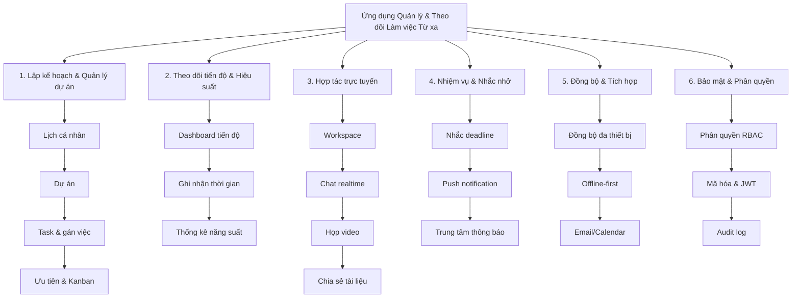

# Tài liệu 1 — Mô tả tóm tắt ứng dụng

> **Đồ án Mobile App — Đề tài 21**
> Ứng dụng quản lý và theo dõi làm việc từ xa
> Buổi báo cáo BTL: 25/09/2026 · Thời lượng trình bày: 10–15 phút

---

## 1. Tên đề tài & định vị

**Ứng dụng quản lý và theo dõi làm việc từ xa**

Ứng dụng mobile **tất-cả-trong-một** dành cho cá nhân và nhóm nhỏ làm việc từ xa: quản lý công việc, theo dõi tiến độ, cộng tác và nhắc nhở — tất cả trong một ứng dụng Android, hoạt động được cả khi mất mạng.

---

## 2. Mục đích xây dựng (Vấn đề cần giải quyết)

Làm việc từ xa (remote/hybrid) ngày càng phổ biến nhưng nhóm nhỏ và sinh viên gặp nhiều khó khăn:

| Vấn đề thực tế | Hệ quả |
|---|---|
| Công việc nằm rải rác ở nhiều nơi (chat, ghi chú, giấy) | Khó biết ai đang làm gì, dễ trùng việc |
| Không có công cụ theo dõi tiến độ tập trung | Trưởng nhóm không nắm được tiến độ thật |
| Deadline bị bỏ sót | Trễ hạn, giảm chất lượng |
| Giao tiếp và quản lý việc tách rời nhau | Phải mở nhiều app, tốn thời gian |
| Công cụ chuyên nghiệp (Asana, Monday, Jira) quá phức tạp & tính phí theo người dùng | Không phù hợp nhóm nhỏ/sinh viên |
| Di chuyển nhiều, mạng chập chờn | Ứng dụng online-only không dùng được |

**Mục tiêu của ứng dụng:**
- Gom toàn bộ quy trình làm việc nhóm vào **một ứng dụng mobile duy nhất**.
- Giúp cá nhân **không bỏ sót deadline** nhờ nhắc nhở tự động.
- Cho trưởng nhóm **nhìn thấy tiến độ và hiệu suất** một cách trực quan.
- **Hoạt động offline**, tự đồng bộ khi có mạng.
- Miễn phí / chi phí thấp, giao diện **tiếng Việt**, phù hợp người dùng Việt Nam.

---

## 3. Đối tượng người dùng

| Nhóm | Nhu cầu chính |
|---|---|
| Sinh viên / nhóm làm đồ án | Chia việc, deadline bài tập, báo cáo tiến độ |
| Nhóm làm việc từ xa quy mô nhỏ (startup, freelancer) | Quản lý dự án, cộng tác, họp nhóm |
| Cá nhân làm việc đa nhiệm | Lịch làm việc cá nhân, nhắc việc, đo năng suất |

---

## 4. Chức năng chính

Ứng dụng bám sát **6 nhóm chức năng** của đề tài:

| # | Nhóm chức năng | Nội dung cụ thể |
|---|---|---|
| 1 | **Lập kế hoạch & Quản lý dự án** | Tạo lịch làm việc cá nhân; tạo/quản lý dự án; tạo & gán công việc; ưu tiên, gắn nhãn; xem dạng Kanban/danh sách/lịch |
| 2 | **Theo dõi tiến độ & Hiệu suất** | Dashboard tiến độ dự án (% hoàn thành); theo dõi task cá nhân; ghi nhận thời gian làm việc; thống kê năng suất và mức độ hoàn thành |
| 3 | **Hợp tác trực tuyến & Giao tiếp** | Không gian làm việc chung; chat nhóm/1-1 realtime; họp video nhóm; chia sẻ tài liệu có phân quyền |
| 4 | **Quản lý nhiệm vụ & Nhắc nhở** | Nhắc deadline tự động (nhiều mốc); push notification; trung tâm thông báo; thông báo khi được giao việc |
| 5 | **Đồng bộ & Tích hợp** | Đồng bộ dữ liệu đa thiết bị; chế độ **offline-first**; tích hợp email & calendar |
| 6 | **Bảo mật & Phân quyền** | Phân quyền theo vai trò (Owner/Admin/Member/Viewer); mã hóa dữ liệu & token; quản lý phiên đăng nhập; nhật ký hoạt động |

### Sơ đồ chức năng tổng quát

---

## 5. Luồng sử dụng chính (kịch bản demo)

1. Người dùng **đăng ký / đăng nhập**.
2. Trưởng nhóm **tạo dự án**, **mời thành viên** qua email.
3. Trưởng nhóm **tạo công việc**, gán cho thành viên kèm **deadline và độ ưu tiên**.
4. Thành viên **nhận thông báo**, kéo thả công việc trên **Kanban board** khi hoàn thành.
5. Hệ thống **nhắc nhở trước deadline** và cảnh báo khi **quá hạn**.
6. Trưởng nhóm xem **dashboard tiến độ** và **thống kê năng suất**.
7. Nhóm **chat** trong kênh dự án và **họp video** khi cần.
8. Mọi thao tác **hoạt động khi offline** và **tự đồng bộ** khi có mạng.

---

## 6. Phạm vi bản đầu (MVP) và hướng mở rộng

**Bản MVP (bắt buộc hoàn thành):**
Đăng nhập · Quản lý dự án & thành viên · Quản lý & gán công việc (Kanban) · Lịch cá nhân · Dashboard tiến độ · Chat nhóm realtime · Nhắc deadline + push notification · Đồng bộ offline cơ bản.

**Hướng mở rộng (nếu còn thời gian):**
Họp video nhóm · Chia sẻ tài liệu · Thống kê nâng cao (burndown/velocity) · Tích hợp Google Calendar & email · Audit log · Xác thực 2 lớp.

---

## 7. Kết quả mong đợi (sản phẩm đầu ra)

- **Ứng dụng Android** (Kotlin) hoàn chỉnh, cài đặt và chạy được trên thiết bị thật.
- **Backend** Spring Boot + PostgreSQL triển khai trên server, có tài liệu API (Swagger).
- **Báo cáo đồ án** + slide thuyết trình + video/kịch bản demo.
- **Dữ liệu mẫu** để trình diễn đầy đủ luồng nghiệp vụ.

---

## 8. Nội dung cần nhấn khi trình bày (gợi ý 4–5 phút)

- Nêu **vấn đề thực tế** của làm việc từ xa (bảng ở mục 2) → tạo đồng cảm với người nghe.
- Nhấn mạnh ứng dụng **gom 6 nhóm chức năng vào một app mobile**, không phải công cụ chỉ làm 1 việc.
- Điểm gây ấn tượng kỹ thuật: **offline-first** + **realtime** + **nhắc nhở tự động**.
- Chốt bằng **kịch bản demo** ở mục 5 để người nghe hình dung sản phẩm.
