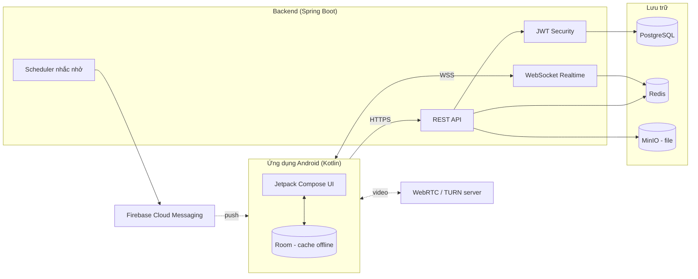

# Tài liệu 2 — Công nghệ dự kiến sử dụng

> **Đồ án Mobile App — Đề tài 21**
> Ứng dụng quản lý và theo dõi làm việc từ xa
> Buổi báo cáo BTL: 25/09/2026

---

## 1. Kiến trúc tổng quan

Ứng dụng theo mô hình **Client–Server**, mobile giao tiếp với backend qua **REST API** (nghiệp vụ) và **WebSocket** (chat, trạng thái online, tín hiệu họp video). Backend dùng chung cho mọi thiết bị nên **đồng bộ dữ liệu đa thiết bị** là tự nhiên.

**Nguyên tắc thiết kế:**
- **Offline-first:** app lưu dữ liệu cục bộ (Room), dùng được khi mất mạng, tự đồng bộ khi có mạng.
- **Realtime hai kênh:** WebSocket khi app đang mở, FCM push khi app ở nền.
- **Bảo mật theo lớp:** JWT, phân quyền RBAC, mã hóa khi truyền (TLS).

---

## 2. Công nghệ phía Mobile (Android)

| Thành phần | Công nghệ | Lý do chọn |
|---|---|---|
| Ngôn ngữ | **Kotlin** | Ngôn ngữ chính thức của Android, yêu cầu của môn học |
| Giao diện | **Jetpack Compose** + Material 3 | Khai báo, ít code hơn XML, hỗ trợ dark mode |
| Kiến trúc | **MVVM + Clean Architecture** | Tách UI / nghiệp vụ / dữ liệu, dễ test & mở rộng |
| Điều hướng | Navigation Compose | Chuẩn của Google |
| Bất đồng bộ | Coroutines + Flow | Xử lý tác vụ nền, luồng dữ liệu reactive |
| Tiêm phụ thuộc (DI) | **Hilt** | Giảm code khởi tạo, dễ test |
| Gọi API | Retrofit + OkHttp + Kotlinx Serialization | Thư viện phổ biến, ổn định |
| Lưu trữ offline | **Room** | Cơ sở dữ liệu cục bộ, hỗ trợ offline-first |
| Lưu token | DataStore + EncryptedSharedPreferences | Lưu an toàn access/refresh token |
| Đồng bộ nền | **WorkManager** | Chạy tác vụ đồng bộ định kỳ, tự retry |
| Realtime | OkHttp WebSocket (STOMP) | Kết nối chat & presence |
| Thông báo | **Firebase Cloud Messaging** | Push notification miễn phí, chuẩn Android |
| Hình ảnh | Coil | Load avatar/ảnh đính kèm |
| Phân trang | Paging 3 | Danh sách task/tin nhắn dài không giật |
| Video call | WebRTC (stream-webrtc-android) hoặc SDK Jitsi/Agora | Họp video nhóm (xem mục 6) |
| Kiểm thử | JUnit5, MockK, Turbine, Compose UI Test | Unit test + UI test |

---

## 3. Công nghệ phía Backend

| Thành phần | Công nghệ | Lý do chọn |
|---|---|---|
| Ngôn ngữ | **Java 21 (LTS)** | Bản LTS ổn định, nhiều tính năng hiện đại |
| Framework | **Spring Boot 3.3+** | Hệ sinh thái mạnh, tài liệu phong phú, phù hợp đồ án |
| REST API | Spring Web MVC | Xây dựng API theo chuẩn |
| Bảo mật | **Spring Security + JWT** | Xác thực & phân quyền chuyên nghiệp |
| Realtime | Spring WebSocket (STOMP) + Redis Pub/Sub | Chat, presence, signaling họp video |
| Truy cập CSDL | Spring Data JPA / Hibernate | Giảm code CRUD, quản lý quan hệ tốt |
| Di trú CSDL | **Flyway** | Quản lý phiên bản schema bằng script |
| Lập lịch | Spring `@Scheduled` | Quét deadline, gửi nhắc nhở tự động |
| Gửi email | Spring Mail (SMTP) | Lời mời dự án, nhắc nhở qua email |
| Tài liệu API | springdoc-openapi (Swagger UI) | Tự sinh tài liệu API để demo |
| Ánh xạ DTO | MapStruct + Lombok | Giảm code lặp |
| Kiểm thử | JUnit5, Mockito, Testcontainers | Test tầng service & repository |
| Build | Gradle (Kotlin DSL) | Thống nhất với phía Android |

---

## 4. Cơ sở dữ liệu & lưu trữ

| Thành phần | Công nghệ | Vai trò |
|---|---|---|
| CSDL chính | **PostgreSQL 16** | Dữ liệu quan hệ: người dùng, dự án, task, tin nhắn |
| Cache & realtime | **Redis** | Trạng thái online, cache, pub/sub cho WebSocket |
| Lưu tệp | **MinIO** (tương thích S3) | Tài liệu, ảnh đính kèm; có thể tự host |
| CSDL cục bộ (app) | SQLite qua Room | Cache offline trên thiết bị |

**Khoá chính dùng UUID** — cho phép app tự tạo dữ liệu khi offline mà không lo trùng ID khi đồng bộ.

---

## 5. Hạ tầng, công cụ & triển khai

| Hạng mục | Công nghệ |
|---|---|
| Đóng gói & chạy dịch vụ | **Docker + Docker Compose** (PostgreSQL, Redis, MinIO, backend) |
| Reverse proxy / HTTPS | Nginx + Let's Encrypt |
| CI/CD | GitHub Actions (build, test, lint mỗi lần push) |
| Triển khai demo | VPS hoặc nền tảng cloud (Render/Railway/Fly.io) |
| STUN/TURN cho video | coturn |
| Quản lý mã nguồn | Git + GitHub (quy trình branch, pull request) |
| Công cụ phát triển | Android Studio, IntelliJ IDEA, Postman, Figma, DBeaver/pgAdmin |
| Chất lượng code | ktlint/detekt (Android), Spotless (Java) |

---

## 6. Điểm kỹ thuật đáng chú ý

1. **Offline-first:** Room là nguồn dữ liệu chính trên app; thao tác khi mất mạng được xếp hàng và tự đồng bộ bằng WorkManager, xử lý xung đột theo nguyên tắc *last-write-wins*.
2. **Realtime:** WebSocket (STOMP) cho chat và trạng thái online; FCM chỉ gửi push khi người dùng không online → tiết kiệm và không trùng thông báo.
3. **Nhắc nhở tự động:** bộ lập lịch ở backend quét deadline theo nhiều mốc cấu hình (trước 1 ngày, trước 1 giờ, quá hạn), chống gửi trùng.
4. **Bảo mật:** access token ngắn hạn + refresh token dài hạn có thể thu hồi; phân quyền RBAC kiểm tra ở backend; token lưu trong EncryptedSharedPreferences.
5. **Video call:** tự dựng signaling qua WebSocket + WebRTC (P2P, dùng TURN khi cần). **Phương án dự phòng:** dùng SDK Jitsi/Agora nếu thời gian gấp để tập trung vào nghiệp vụ chính.

---

## 7. Yêu cầu môi trường

| Phía | Yêu cầu |
|---|---|
| Phát triển Android | Android Studio (JDK 17+), SDK API 26+ |
| Thiết bị chạy app | Android 8.0 (API 26) trở lên |
| Phát triển backend | JDK 21, Gradle, Docker |
| Máy chủ demo | Tối thiểu 2 GB RAM, có IP công khai hoặc domain |
| Dịch vụ ngoài | Tài khoản Firebase (FCM), SMTP gửi mail |

---

## 8. Nội dung cần nhấn khi trình bày (gợi ý 4–5 phút)

- Nói rõ **lý do chọn từng công nghệ** (cột "Lý do chọn" trong bảng) — thầy thường hỏi "vì sao dùng cái này".
- Nhấn điểm ăn điểm: **Kotlin + Compose** (hiện đại), **Spring Boot** (backend chuyên nghiệp), **offline-first**, **realtime**.
- Chỉ rõ **thách thức kỹ thuật**: đồng bộ offline & họp video (kèm phương án dự phòng).
- Nhấn mạnh **chi phí thấp**: dùng công nghệ mã nguồn mở, tự host bằng Docker.
