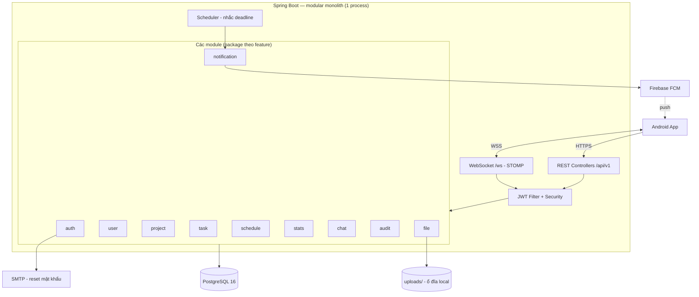

# Plan Backend 01 — Kiến trúc dự án & Stack

> Bộ tài liệu `docs/plan-backend/`: kế hoạch triển khai backend.
> Nguyên tắc xuyên suốt: **modular monolith (micro mono)** — một ứng dụng, một cơ sở dữ liệu, chia module theo feature.
> **Tuyệt đối không phân tán:** không microservice, không message broker, không API gateway, không service mesh.

---

## 1. Nguyên tắc kiến trúc

1. **Modular monolith:** toàn bộ backend là **một** Spring Boot application, **một** PostgreSQL. Chia tách bằng package theo feature + quy tắc dependency giữa các module, **không** tách bằng network.
2. **Đơn giản trước:** mỗi chức năng làm theo cách ít thành phần nhất có thể; chỉ tách/thêm hạ tầng khi thực sự cần (Redis, MinIO, queue... đều để sau).
3. **Stateless:** JWT, không lưu session server — restart không mất phiên, cần thì scale được.
4. **Phân quyền ở backend:** mọi request đều kiểm tra vai trò tại service layer, không tin UI.
5. **Module là tính năng, không phải dịch vụ:** `auth`, `task`, `chat`... là các package trong cùng một JVM, gọi nhau qua interface của service.

---

## 2. Sơ đồ kiến trúc



---

## 3. Cấu trúc dự án (Maven — single module)

Một Maven module duy nhất, package theo feature. Đây là dạng **đơn giản nhất** của modular monolith: vẫn 1 artifact để deploy, tách biệt bằng package + quy tắc dependency.

```
backend/
 ├─ pom.xml
 ├─ mvnw · mvnw.cmd · .mvn/
 ├─ src/main/java/com/example/remoteapp/
 │   ├─ RemoteAppApplication.java
 │   ├─ config/          # SecurityConfig, WebSocketConfig, OpenAPIConfig, JacksonConfig, SchedulingConfig
 │   ├─ common/          # ApiResponse, ErrorCode, AppException, GlobalExceptionHandler,
 │   │                   # BaseEntity (id, createdAt, updatedAt, deletedAt), util
 │   ├─ auth/            # AuthController, AuthService, JwtService, JwtAuthenticationFilter,
 │   │                   # TokenService (refresh token), dto/
 │   ├─ user/            # UserController, UserService, User, Device, dto/
 │   ├─ project/         # ProjectController, ProjectService, ProjectPermissionService,
 │   │                   # InviteService, Project, ProjectMember, ProjectInvite, dto/
 │   ├─ task/            # TaskController, TaskService, TaskCommentService,
 │   │                   # Task, TaskAssignee, Label, TaskLabel, TaskComment, dto/
 │   ├─ schedule/        # ScheduleController, ScheduleService, ScheduleEvent, dto/
 │   ├─ stats/           # StatsController, StatsService, StatsRepository (JdbcTemplate), dto/
 │   ├─ chat/            # ChatController, ChatService, ChatWsController, Conversation,
 │   │                   # ConversationMember, Message, ws/, dto/
 │   ├─ notification/    # NotificationController, NotificationService, ReminderScheduler,
 │   │                   # PushSender/FcmPushSender/NoopPushSender, Notification, dto/
 │   ├─ audit/           # AuditService, AuditLog, dto/ (đọc qua ProjectController)
 │   └─ file/            # FileController, StorageService, LocalStorageService,
 │                       # SupabaseStorageService, FileMeta, dto/
 ├─ src/main/resources/
 │   ├─ application.yml
 │   └─ db/migration/
 │       ├─ V1__users_auth.sql
 │       ├─ V2__projects.sql
 │       ├─ V3__tasks.sql
 │       ├─ V4__schedule.sql
 │       ├─ V5__chat.sql
 │       └─ V6__notifications_files.sql
 └─ src/test/java/...    # unit test service + integration test repository/controller
```

**Ghi chú:** dùng single Maven module thay vì multi-module Maven — quy mô đồ án không cần tách artifact; nếu sau này muốn, việc tách module Maven vẫn giữ nguyên kiến trúc (vẫn deploy 1 process).

---

## 4. Phân tầng & quy tắc dependency giữa module

### 4.1 Phân tầng trong mỗi module

```
controller  →  service  →  repository (Spring Data JPA)  →  entity
                 ↓
        DTO (Java record) + validation
```

- **Controller:** nhận request, validate DTO, gọi service, trả response. Không viết logic nghiệp vụ.
- **Service:** nghiệp vụ + **kiểm tra phân quyền**. Transaction ở đây (`@Transactional`).
- **Repository:** query JPA/JPQL. Repository chỉ dùng cho **module của nó**.
- **DTO:** Java `record`, mapping thủ công (không MapStruct).

### 4.2 Quy tắc dependency giữa các module

| Module | Được phép gọi (qua public service) |
|---|---|
| auth | user (tạo user, đổi mật khẩu), audit (USER_PASSWORD_CHANGED) |
| user | file (upload avatar) |
| project | user (ghép tên thành viên), audit (PROJECT_*, MEMBER_*, INVITE_*) |
| task | project (ProjectPermissionService/ProjectService), user, file, notification, audit |
| schedule | user, task (validate `taskId` liên kết) |
| stats | chỉ **đọc** bảng của task/project/schedule bằng query tổng hợp riêng (StatsRepository) |
| chat | project, user, file, notification, audit |
| notification | user (lấy device token); **đọc** bảng task/task_assignees bằng query tổng hợp riêng cho reminder |
| audit | — |
| file | project (ProjectPermissionService) |

- **Không** truy cập repository của module khác. Ngoại lệ duy nhất là **query đọc tổng hợp**:
  `stats` (dashboard/thống kê) và `notification` (scheduler nhắc deadline) — không sửa dữ liệu module khác.
- **Group chat lazy:** `project` **không** gọi `chat` khi tạo dự án; `ChatService.ensureGroupConversation`
  tạo kênh GROUP ở lần truy cập đầu (tránh circular bean dependency).
- **Không** dependency vòng tròn: mọi kiểm tra quyền đi qua `ProjectPermissionService` (module `project`).
- `notification` được gọi từ `task`/`chat` qua interface `NotificationService` — không gọi ngược.

### 4.3 Xử lý lỗi thống nhất

- `AppException(ErrorCode, message)` ném từ service → `GlobalExceptionHandler` trả về format lỗi thống nhất (mục 6.1 `02-danh-sach-api.md`).
- `ErrorCode` enum: `USER_NOT_FOUND`, `PROJECT_FORBIDDEN`, `TASK_DEADLINE_INVALID`, `INVITE_INVALID`, `FILE_TOO_LARGE`...

---

## 5. Luồng xử lý

**REST:**
```
Request → JwtAuthenticationFilter (xác thực token, gắn SecurityContext)
       → Controller (@Valid DTO)
       → Service (nghiệp vụ + phân quyền + audit)
       → Repository → PostgreSQL
       → Response DTO (hoặc AppException → lỗi thống nhất)
```

**WebSocket (chat):**
```
Handshake /ws (kiểm tra JWT) → STOMP
Client SEND /app/chat.send → ChatWsController → ChatService (lưu DB)
                           → SimpMessagingTemplate broadcast /topic/conversations.{id}
                           → FCM push cho thành viên còn lại
```

**Scheduler (nhắc deadline):**
```
@Scheduled (mỗi 5 phút) → ReminderService quét task tới hạn/quá hạn
                        → NotificationService (lưu DB, unique chặn trùng)
                        → FcmService (push)
```

---

## 6. Stack công nghệ

| Thành phần | Lựa chọn | Ghi chú |
|---|---|---|
| Ngôn ngữ | Java 21 (LTS) | |
| Framework | Spring Boot 3.3.x | |
| Build | **Maven** (có `mvnw` wrapper) | Đổi từ Gradle theo yêu cầu |
| Web | Spring Web MVC | REST |
| Bảo mật | Spring Security + jjwt 0.12.x | JWT HS256 |
| Realtime | Spring WebSocket (STOMP) | Broker in-memory |
| ORM | Spring Data JPA / Hibernate | |
| CSDL | PostgreSQL 16 | |
| Migration | Flyway | |
| Email | Spring Mail | Chỉ quên mật khẩu |
| Push | firebase-admin | No-op khi `FCM_ENABLED=false` |
| File | Object storage S3-compatible (Supabase REST) | `LocalStorageService` fallback dev/test; đổi MinIO/S3 chỉ cần implementation mới |
| API docs | springdoc-openapi | Swagger UI |
| Validation | Jakarta Bean Validation | |
| Tiện ích | Lombok (cho entity) | DTO dùng `record` |

### 6.1 Dependency chính trong `pom.xml`

```xml
<parent>spring-boot-starter-parent 3.3.x</parent>
<properties><java.version>21</java.version></properties>

<dependencies>
  spring-boot-starter-web
  spring-boot-starter-data-jpa
  spring-boot-starter-security
  spring-boot-starter-validation
  spring-boot-starter-websocket
  spring-boot-starter-mail
  spring-boot-starter-actuator          <!-- health check -->
  io.jsonwebtoken:jjwt-api / jjwt-impl / jjwt-jackson (0.12.x, runtime)
  org.postgresql:postgresql
  org.flywaydb:flyway-core + flyway-database-postgresql
  org.projectlombok:lombok (optional)
  org.springdoc:springdoc-openapi-starter-webmvc-ui (2.x)

  <!-- test -->
  spring-boot-starter-test
  spring-security-test
  org.testcontainers:junit-jupiter + postgresql
</dependencies>
```

### 6.2 Lệnh build & chạy

```bash
./mvnw spring-boot:run          # chạy local (profile local)
./mvnw test                     # unit + integration test
./mvnw package                  # tạo jar
```

---

## 7. Cấu hình & môi trường

- `application.yml`: cấu hình chung; `application-local.yml` / `application-prod.yml`: profile riêng.
- **Biến môi trường (không commit secret):** `DB_URL`, `DB_USERNAME`, `DB_PASSWORD`, `JWT_SECRET`, `MAIL_HOST/PORT/USERNAME/PASSWORD`, `MAIL_FROM`, `STORAGE_TYPE`, `STORAGE_BASE_URL`, `STORAGE_SERVICE_KEY`, `STORAGE_BUCKET`, `STORAGE_PUBLIC_URL`, `UPLOAD_DIR`, `FCM_ENABLED`, `FCM_CREDENTIALS_BASE64`, `APP_TIMEZONE`, `REMINDER_INTERVAL_MS`, `REMINDER_INITIAL_DELAY_MS`.
- Dev local bằng Docker Compose: `postgres:16` + `mailpit` (SMTP giả, bắt email reset mật khẩu). Backend chạy trực tiếp từ IDE; file dùng đĩa local, push no-op.
- **Deploy:** phase 1 đã triển khai Render (Docker) + Neon — xem `docs/plan-deploy/01-ci-cd-phase-1.md`; dịch vụ ngoài Supabase/FCM ở `docs/plan-deploy/02-dich-vu-ngoai.md`.

---

## 8. Cơ sở dữ liệu

- PostgreSQL 16, khoá chính **UUID** (theo ADR-06), mọi bảng có `created_at`, `updated_at`, bảng nghiệp vụ có `deleted_at`.
- Danh sách bảng chi tiết: xem `../04-thiet-ke-backend.md` mục 5 (16 bảng). Migration chia 5 file Flyway như mục 3.
- Index chính: `tasks(project_id)`, `tasks(deadline)`, `tasks(status)`, `messages(conversation_id, created_at)`, `notifications(user_id, read_at)`, `audit_logs(project_id, created_at)`, `project_invites(code)`.

---

## 9. Quy ước code

- Package theo feature; mỗi feature có `controller / service / repository / entity / dto`.
- Entity: JPA + Lombok `@Getter @Setter`, kế thừa `BaseEntity` (UUID id, timestamps, soft delete).
- DTO: Java `record` + annotation `@NotBlank`, `@Email`...; map entity ↔ DTO thủ công trong service.
- Exception: ném `AppException(ErrorCode)`; không trả lỗi kiểu khác.
- Response thành công: DTO trực tiếp (hoặc `Page<T>` khi phân trang); lỗi theo format thống nhất.
- Logging: SLF4J; **không** log mật khẩu/token.
- Test: service thuần (Mockito) + repository/controller (Testcontainers PostgreSQL).
