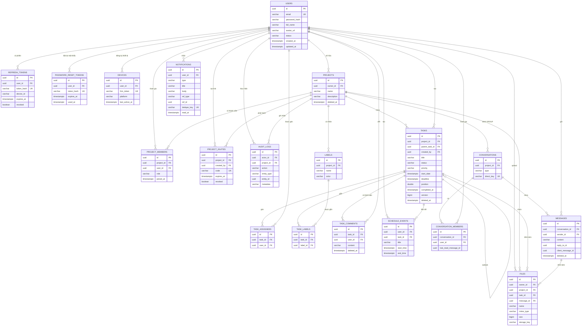

# Schema cơ sở dữ liệu — Remote Work Management

> Nguồn sự thật: `backend/src/main/resources/db/migration/V1`–`V6` (Flyway).
> 19 bảng, PostgreSQL 16+, khoá chính **UUID**, mọi bảng có `created_at`/`updated_at`.
> ERD render trực tiếp trên GitHub; nếu cần ảnh, copy block Mermaid sang <https://mermaid.live>.

---

## 1. Đọc nhanh trong 30 giây

| Nhóm | Bảng | Việc nó làm |
|---|---|---|
| **Tài khoản** (4) | `users`, `refresh_tokens`, `password_reset_tokens`, `devices` | đăng nhập, phiên, quên mật khẩu, token FCM |
| **Dự án & quyền** (4) | `projects`, `project_members`, `project_invites`, `audit_logs` | dự án, vai trò theo dự án, link mời, nhật ký |
| **Công việc** (5) | `tasks`, `task_assignees`, `labels`, `task_labels`, `task_comments` | task/checklist, gán người, nhãn, bình luận |
| **Lịch** (1) | `schedule_events` | sự kiện cá nhân (có thể gắn task) |
| **Chat** (3) | `conversations`, `conversation_members`, `messages` | kênh GROUP/DIRECT, read receipt, tin nhắn |
| **Thông báo & file** (2) | `notifications`, `files` | trung tâm thông báo, metadata file đính kèm |

**3 chuỗi chính**

```
USERS ──< PROJECTS ──< PROJECT_MEMBERS >── USERS          (ai thuộc dự án nào, vai trò gì)
PROJECTS ──< TASKS ──< TASK_ASSIGNEES >── USERS
                     ├──< TASK_LABELS >── LABELS
                     ├──< TASK_COMMENTS
                     └──< FILES
PROJECTS ──< CONVERSATIONS ──< MESSAGES >── USERS
                             └──< CONVERSATION_MEMBERS >── USERS
```

---

## 2. ERD đầy đủ (19 bảng)



---

## 3. Catalog từng bảng

Ký hiệu: `PK` khoá chính, `FK` khoá ngoại, `UK` unique, `?` nullable.

### 3.1 Tài khoản & xác thực

#### `users`
| Cột | Kiểu | Ràng buộc | Ghi chú |
|---|---|---|---|
| `id` | UUID | PK | Hibernate sinh |
| `email` | VARCHAR(255) | NOT NULL, UK | luôn lowercase |
| `password_hash` | VARCHAR(255) | NOT NULL | BCrypt cost 10 |
| `full_name` | VARCHAR(100) | NOT NULL | |
| `avatar_url` | VARCHAR(500) | ? | `/api/v1/files/{id}` |
| `status` | VARCHAR(20) | NOT NULL, default `ACTIVE` | `ACTIVE` / `LOCKED` |
| `created_at`, `updated_at` | TIMESTAMPTZ | NOT NULL | |

#### `refresh_tokens`
| Cột | Kiểu | Ràng buộc | Ghi chú |
|---|---|---|---|
| `id` | UUID | PK | |
| `user_id` | UUID | FK → `users.id` | |
| `token_hash` | VARCHAR(64) | NOT NULL, UK | SHA-256 của refresh token (không lưu raw) |
| `device_id` | VARCHAR(100) | ? | |
| `expires_at` | TIMESTAMPTZ | NOT NULL | 30 ngày |
| `revoked` | BOOLEAN | NOT NULL, default false | rotate/logout |
| timestamps | | | |

#### `password_reset_tokens`
| Cột | Kiểu | Ràng buộc | Ghi chú |
|---|---|---|---|
| `id` | UUID | PK | |
| `user_id` | UUID | FK → `users.id` | |
| `token_hash` | VARCHAR(64) | NOT NULL, UK | dùng 1 lần |
| `expires_at` | TIMESTAMPTZ | NOT NULL | 30 phút |
| `used_at` | TIMESTAMPTZ | ? | null = chưa dùng |
| timestamps | | | |

#### `devices`
| Cột | Kiểu | Ràng buộc | Ghi chú |
|---|---|---|---|
| `id` | UUID | PK | |
| `user_id` | UUID | FK → `users.id` | |
| `fcm_token` | VARCHAR(500) | NOT NULL, UK | token hỏng → xoá |
| `platform` | VARCHAR(20) | NOT NULL | `ANDROID`, `IOS`... |
| `last_active_at` | TIMESTAMPTZ | ? | |
| timestamps | | | |

### 3.2 Dự án, thành viên, quyền, audit

#### `projects`
| Cột | Kiểu | Ràng buộc | Ghi chú |
|---|---|---|---|
| `id` | UUID | PK | |
| `name` | VARCHAR(100) | NOT NULL | |
| `description` | VARCHAR(1000) | ? | |
| `owner_id` | UUID | FK → `users.id` | người tạo |
| `deleted_at` | TIMESTAMPTZ | ? | **soft delete** |
| timestamps | | | |

#### `project_members` — bảng RBAC
| Cột | Kiểu | Ràng buộc | Ghi chú |
|---|---|---|---|
| `id` | UUID | PK | |
| `project_id` | UUID | FK → `projects.id` | |
| `user_id` | UUID | FK → `users.id` | |
| `role` | VARCHAR(20) | NOT NULL | `OWNER` / `ADMIN` / `MEMBER` / `VIEWER` |
| `joined_at` | TIMESTAMPTZ | NOT NULL, default now() | |
| timestamps | | | |
| | | **UK(project_id, user_id)** | 1 người 1 vai trò/dự án |

#### `project_invites`
| Cột | Kiểu | Ràng buộc | Ghi chú |
|---|---|---|---|
| `id` | UUID | PK | |
| `project_id` | UUID | FK → `projects.id` | |
| `code` | VARCHAR(12) | NOT NULL, UK | `[A-Z0-9]{12}` |
| `created_by` | UUID | FK → `users.id` | |
| `expires_at` | TIMESTAMPTZ | ? | null = không hết hạn |
| `revoked` | BOOLEAN | NOT NULL, default false | |
| timestamps | | | |

#### `audit_logs`
| Cột | Kiểu | Ràng buộc | Ghi chú |
|---|---|---|---|
| `id` | UUID | PK | |
| `actor_id` | UUID | FK → `users.id`, ? | null nếu hệ thống |
| `project_id` | UUID | FK → `projects.id`, ? | null nếu hành động cấp tài khoản |
| `action` | VARCHAR(50) | NOT NULL | enum `AuditAction` |
| `entity_type` | VARCHAR(50) | NOT NULL | `PROJECT`, `TASK`, `MEMBER`, `INVITE`, `COMMENT`, `USER` |
| `entity_id` | UUID | ? | **polymorphic**, không FK |
| `metadata` | VARCHAR(2000) | ? | chuỗi ngắn (`role=ADMIN`...) |
| timestamps | | | |

### 3.3 Task, checklist, nhãn, bình luận

#### `tasks`
| Cột | Kiểu | Ràng buộc | Ghi chú |
|---|---|---|---|
| `id` | UUID | PK | |
| `project_id` | UUID | FK → `projects.id` | |
| `parent_task_id` | UUID | FK → `tasks.id`, ? | subtask/checklist (1 cấp) |
| `title` | VARCHAR(200) | NOT NULL | |
| `description` | VARCHAR(5000) | ? | |
| `status` | VARCHAR(20) | NOT NULL | `TODO` / `DOING` / `REVIEW` / `DONE` |
| `priority` | VARCHAR(20) | NOT NULL | `LOW` / `MEDIUM` / `HIGH` / `URGENT` |
| `start_date` | TIMESTAMPTZ | ? | timeline |
| `deadline` | TIMESTAMPTZ | ? | nhắc deadline |
| `position` | DOUBLE PRECISION | NOT NULL, default 0 | Kanban kéo thả |
| `created_by` | UUID | FK → `users.id` | |
| `completed_at` | TIMESTAMPTZ | ? | set khi DONE |
| `version` | BIGINT | NOT NULL, default 0 | optimistic locking |
| `deleted_at` | TIMESTAMPTZ | ? | **soft delete** (kèm subtask) |
| timestamps | | | |

#### `task_assignees`
| Cột | Kiểu | Ràng buộc | Ghi chú |
|---|---|---|---|
| `id` | UUID | PK | |
| `task_id` | UUID | FK → `tasks.id` | |
| `user_id` | UUID | FK → `users.id` | |
| timestamps | | | |
| | | **UK(task_id, user_id)** | |

#### `labels`
| Cột | Kiểu | Ràng buộc | Ghi chú |
|---|---|---|---|
| `id` | UUID | PK | |
| `project_id` | UUID | FK → `projects.id` | nhãn theo dự án |
| `name` | VARCHAR(50) | NOT NULL | |
| `color` | VARCHAR(20) | NOT NULL | hex/tên màu |
| timestamps | | | |
| | | **UK(project_id, name)** | không trùng tên trong dự án |

#### `task_labels`
| Cột | Kiểu | Ràng buộc | Ghi chú |
|---|---|---|---|
| `id` | UUID | PK | |
| `task_id` | UUID | FK → `tasks.id` | |
| `label_id` | UUID | FK → `labels.id` | |
| timestamps | | | |
| | | **UK(task_id, label_id)** | |

#### `task_comments`
| Cột | Kiểu | Ràng buộc | Ghi chú |
|---|---|---|---|
| `id` | UUID | PK | |
| `task_id` | UUID | FK → `tasks.id` | |
| `user_id` | UUID | FK → `users.id` | tác giả |
| `content` | VARCHAR(2000) | NOT NULL | |
| `deleted_at` | TIMESTAMPTZ | ? | **soft delete** |
| timestamps | | | |

### 3.4 Lịch cá nhân

#### `schedule_events`
| Cột | Kiểu | Ràng buộc | Ghi chú |
|---|---|---|---|
| `id` | UUID | PK | |
| `user_id` | UUID | FK → `users.id` | chủ sự kiện |
| `title` | VARCHAR(200) | NOT NULL | |
| `description` | VARCHAR(2000) | ? | |
| `start_time` | TIMESTAMPTZ | NOT NULL | |
| `end_time` | TIMESTAMPTZ | NOT NULL | phải > start |
| `task_id` | UUID | FK → `tasks.id`, ? | hiển thị deadline |
| timestamps | | | |

### 3.5 Chat

#### `conversations`
| Cột | Kiểu | Ràng buộc | Ghi chú |
|---|---|---|---|
| `id` | UUID | PK | |
| `project_id` | UUID | FK → `projects.id`, ? | null với DIRECT |
| `type` | VARCHAR(10) | NOT NULL | `GROUP` / `DIRECT` |
| `direct_key` | VARCHAR(80) | ?, UK | `minUserId_maxUserId` cho DIRECT |
| timestamps | | | |
| | | **UNIQUE(project_id) WHERE type='GROUP'** | 1 kênh GROUP/dự án |

#### `conversation_members`
| Cột | Kiểu | Ràng buộc | Ghi chú |
|---|---|---|---|
| `id` | UUID | PK | |
| `conversation_id` | UUID | FK → `conversations.id` | |
| `user_id` | UUID | FK → `users.id` | |
| `last_read_message_id` | UUID | ? | **không FK** (tránh vòng; service validate) |
| timestamps | | | |
| | | **UK(conversation_id, user_id)** | |

> GROUP: thành viên suy ra từ `project_members`; bảng này chủ yếu lưu read receipt.
> DIRECT: bảng này là nguồn thành viên thật.

#### `messages`
| Cột | Kiểu | Ràng buộc | Ghi chú |
|---|---|---|---|
| `id` | UUID | PK | |
| `conversation_id` | UUID | FK → `conversations.id` | |
| `sender_id` | UUID | FK → `users.id` | |
| `content` | VARCHAR(4000) | NOT NULL | |
| `reply_to_id` | UUID | ? | **không FK**; service kiểm cùng hội thoại |
| `client_message_id` | UUID | ? | idempotent khi retry |
| `deleted_at` | TIMESTAMPTZ | ? | **soft delete** |
| timestamps | | | |
| | | **UK(conversation_id, client_message_id)** | nhiều NULL vẫn hợp lệ |

### 3.6 Thông báo & file

#### `notifications`
| Cột | Kiểu | Ràng buộc | Ghi chú |
|---|---|---|---|
| `id` | UUID | PK | |
| `user_id` | UUID | FK → `users.id` | người nhận |
| `type` | VARCHAR(30) | NOT NULL | `TASK_ASSIGNED`, `MENTION`, `REMIND_1D`, `REMIND_1H`, `OVERDUE`, `MESSAGE` |
| `title` | VARCHAR(200) | NOT NULL | |
| `body` | VARCHAR(1000) | NOT NULL | |
| `ref_type` | VARCHAR(30) | ? | `TASK` / `CONVERSATION` |
| `ref_id` | UUID | ? | **polymorphic**, không FK |
| `dedupe_key` | VARCHAR(200) | ? | chống trùng nhắc |
| `read_at` | TIMESTAMPTZ | ? | null = chưa đọc |
| timestamps | | | |
| | | **UNIQUE(dedupe_key) WHERE dedupe_key IS NOT NULL** | |

#### `files`
| Cột | Kiểu | Ràng buộc | Ghi chú |
|---|---|---|---|
| `id` | UUID | PK | |
| `owner_id` | UUID | FK → `users.id` | người upload |
| `project_id` | UUID | FK → `projects.id`, ? | null với avatar |
| `task_id` | UUID | FK → `tasks.id`, ? | attachment task |
| `message_id` | UUID | FK → `messages.id`, ? | attachment chat |
| `name` | VARCHAR(255) | NOT NULL | tên gốc |
| `mime_type` | VARCHAR(100) | NOT NULL | whitelist ở service |
| `size` | BIGINT | NOT NULL | byte |
| `storage_key` | VARCHAR(500) | NOT NULL | `{uuid}.{ext}` trên Supabase/đĩa |
| timestamps | | | |

> Một file có thể là avatar (`task_id`/`message_id` null), file dự án, file task hoặc file chat.
> Không có CHECK ràng buộc "đúng một trong hai" — service kiểm theo endpoint.

---

## 4. Index & unique (đúng như migration)

| Bảng | Index / unique |
|---|---|
| `users` | PK; UNIQUE(`email`) |
| `refresh_tokens` | PK; UNIQUE(`token_hash`); INDEX(`user_id`) |
| `password_reset_tokens` | PK; UNIQUE(`token_hash`); INDEX(`user_id`) |
| `devices` | PK; UNIQUE(`fcm_token`); INDEX(`user_id`) |
| `projects` | PK |
| `project_members` | PK; UNIQUE(`project_id`,`user_id`); INDEX(`user_id`) |
| `project_invites` | PK; UNIQUE(`code`); INDEX(`project_id`) |
| `audit_logs` | PK; INDEX(`project_id`,`created_at`) |
| `tasks` | PK; INDEX(`project_id`); INDEX(`deadline`); INDEX(`status`); INDEX(`parent_task_id`); INDEX(`project_id`,`status`,`position`) |
| `task_assignees` | PK; UNIQUE(`task_id`,`user_id`); INDEX(`user_id`) |
| `labels` | PK; UNIQUE(`project_id`,`name`) |
| `task_labels` | PK; UNIQUE(`task_id`,`label_id`); INDEX(`label_id`) |
| `task_comments` | PK; INDEX(`task_id`,`created_at`) |
| `schedule_events` | PK; INDEX(`user_id`,`start_time`) |
| `conversations` | PK; UNIQUE(`direct_key`); UNIQUE(`project_id`) WHERE `type='GROUP'`; INDEX(`project_id`) |
| `conversation_members` | PK; UNIQUE(`conversation_id`,`user_id`); INDEX(`user_id`) |
| `messages` | PK; UNIQUE(`conversation_id`,`client_message_id`); INDEX(`conversation_id`,`created_at`) |
| `notifications` | PK; UNIQUE(`dedupe_key`) WHERE NOT NULL; INDEX(`user_id`,`read_at`); INDEX(`user_id`,`created_at`) |
| `files` | PK; INDEX(`task_id`); INDEX(`message_id`); INDEX(`owner_id`) |

---

## 5. Enum & giá trị cố định

| Cột | Giá trị |
|---|---|
| `users.status` | `ACTIVE`, `LOCKED` |
| `project_members.role` | `OWNER`, `ADMIN`, `MEMBER`, `VIEWER` |
| `tasks.status` | `TODO`, `DOING`, `REVIEW`, `DONE` |
| `tasks.priority` | `LOW`, `MEDIUM`, `HIGH`, `URGENT` |
| `conversations.type` | `GROUP`, `DIRECT` |
| `notifications.type` | `TASK_ASSIGNED`, `MENTION`, `REMIND_1D`, `REMIND_1H`, `OVERDUE`, `MESSAGE` |
| `audit_logs.action` | `PROJECT_CREATED/UPDATED/DELETED`, `MEMBER_JOINED/REMOVED`, `ROLE_CHANGED`, `INVITE_CREATED/REVOKED`, `TASK_CREATED/UPDATED/DELETED`, `TASK_ASSIGNED`, `TASK_STATUS_CHANGED`, `COMMENT_CREATED`, `USER_PASSWORD_CHANGED` |

---

## 6. Quy ước & luật xoá

1. **UUID PK**: Hibernate `@PrePersist` sinh; client có thể gửi idempotency key cho chat (không phải PK).
2. **`created_at` / `updated_at`**: mọi bảng, NOT NULL. `updated_at` do Hibernate `@UpdateTimestamp`.
3. **Soft delete**: chỉ `projects`, `tasks`, `task_comments`, `messages` có `deleted_at`.
   Mọi query phải lọc `deleted_at IS NULL`; xoá project không xoá dữ liệu con.
4. **Không có `ON DELETE CASCADE`**: PostgreSQL mặc định chặn xoá cha nếu còn con.
   App không hard-delete `users/projects/tasks`; file/device/token thì xoá cứng có kiểm soát.
5. **Polymorphic refs không FK**: `audit_logs.entity_id`, `notifications.ref_id`,
   `messages.reply_to_id`, `conversation_members.last_read_message_id` — service kiểm tra.
6. **Role theo dự án**: không lưu role trong JWT; đọc `project_members` mỗi request.
7. **1 kênh GROUP/dự án**: partial unique index; tạo lazy lần đầu.
8. **Chat idempotent**: unique `(conversation_id, client_message_id)`; retry trả tin cũ.
9. **Nhắc deadline không trùng**: partial unique `dedupe_key`; `OVERDUE` có thêm ngày.

---

## 7. Query mẫu hay dùng

```sql
-- 1) Kiểm tra quyền theo dự án (RBAC)
select role from project_members where project_id = :projectId and user_id = :userId;

-- 2) Kanban: task gốc của dự án, theo cột + vị trí
select * from tasks
where project_id = :projectId and parent_task_id is null and deleted_at is null
order by status, position, created_at;

-- 3) "Hôm nay" của tôi: task được gán, chưa xong, quá hạn
select t.* from tasks t
join task_assignees ta on ta.task_id = t.id
where ta.user_id = :userId and t.deleted_at is null and t.status <> 'DONE'
  and t.deadline < :startOfToday
order by t.deadline;

-- 4) Số thông báo chưa đọc
select count(*) from notifications where user_id = :userId and read_at is null;

-- 5) Unread chat: tin của người khác sau mốc đọc cuối
select count(*) from messages m
where m.conversation_id = :conversationId
  and m.sender_id <> :userId
  and m.deleted_at is null
  and m.created_at > coalesce(
      (select created_at from messages where id = :lastReadMessageId),
      '-infinity'::timestamptz);

-- 6) Dashboard dự án
select status, count(*) from tasks
where project_id = :projectId and deleted_at is null
group by status;

-- 7) Kiểm tra kênh GROUP của dự án
select * from conversations where project_id = :projectId and type = 'GROUP';
```

---

## 8. Xem schema trực tiếp trên DB local

```bash
psql -h localhost -U remoteapp -d remoteapp

\dt                 -- danh sách bảng
\d+ tasks           -- cột, index, FK của tasks
\di                 -- tất cả index
\d+ project_members

# dump chỉ schema (không dữ liệu)
pg_dump -h localhost -U remoteapp -d remoteapp --schema-only > /tmp/schema.sql
```

Hoặc xem migration gốc: `backend/src/main/resources/db/migration/V1`–`V6` (nguồn sự thật).
