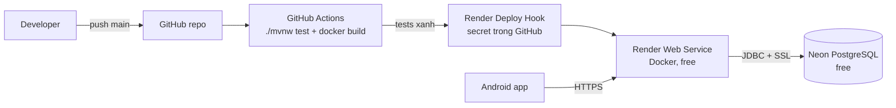
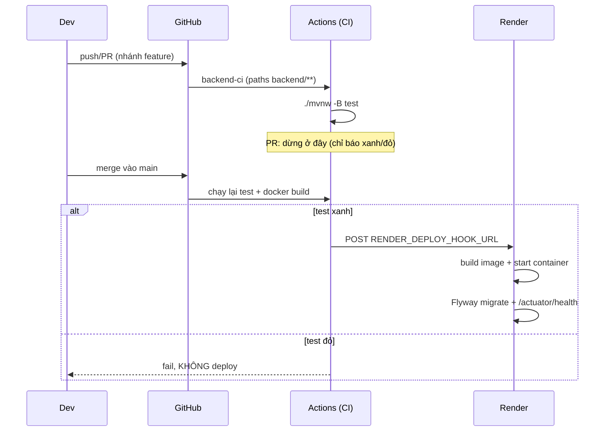

# Plan Deploy 01 — CI/CD phase 1 (Render + Neon, free tier)

> Đồ án môn học: **không deploy VPS**. Phase 1 chỉ cần **backend chạy thật trên Internet** để app
> Android trỏ vào, dùng free tier: **Neon (PostgreSQL)** + **Render (backend Docker)**.
> Tài liệu này là kế hoạch để thống nhất trước khi tạo file/cấu hình (chưa commit gì).

---

## 1. Mục tiêu & phạm vi

**Mục tiêu phase 1**
1. Backend Spring Boot **deploy trên Render** (HTTPS), kết nối **PostgreSQL trên Neon** (SSL).
2. Flyway tự chạy migration khi khởi động — không cần thao tác DB thủ công.
3. **CI/CD**: push lên `main` → GitHub Actions chạy test → **chỉ khi xanh mới trigger deploy** lên Render.
4. Có URL công khai để Android app cấu hình `baseUrl` + có smoke test sau deploy.
5. Không lưu secret trong repo.

**Không nằm trong phase này**
- Build/CI cho Android app (phase sau, làm khi có project Kotlin).
- Domain riêng, CDN, monitoring nâng cao, multi-environment (staging).
- Upload file (Render free **không có persistent disk** — phase task/file sẽ dùng object storage free khác; xem §11).

---

## 2. Kiến trúc deploy



- **Render** build Docker image từ `backend/Dockerfile`, chạy 1 container.
- **Neon** là Postgres serverless: cần SSL (`sslmode=require`), tự ngủ khi không dùng.
- **GitHub Actions** là CI (test) + trigger CD (deploy hook) — Render **không** tự deploy khi có commit
  (để test fail không lên production).

---

## 3. Chuẩn bị tài khoản & quyết định

| Hạng mục | Quyết định | Ghi chú |
|---|---|---|
| Database | **Neon free** (`0.5 GB`, autosuspend) | Region gần VN: `ap-southeast-1` (Singapore) |
| Backend | **Render free Web Service**, runtime **Docker** | 512 MB RAM, spin-down sau ~15 phút idle |
| Build | Multi-stage Dockerfile (Maven → JRE 21) | Không dùng native buildpack để tránh phụ thuộc JDK của Render |
| Deploy trigger | **Deploy Hook** gọi từ GitHub Actions sau khi test xanh | Bật `autoDeploy: false` trong `render.yaml` |
| Secrets | Render dashboard env vars + GitHub repo secrets | Không có file `.env` nào được commit |
| HTTPS | Miễn phí `https://<service>.onrender.com` | App Android dùng trực tiếp URL này |

**Giới hạn free tier cần biết**

| Dịch vụ | Giới hạn | Ảnh hưởng |
|---|---|---|
| Render Web Service | 512 MB RAM, 750 giờ/tháng, spin-down ~15 phút idle, cold start ~30–60 s | Request đầu tiên sau idle rất chậm → app cần timeout ≥ 60 s + retry |
| Neon | 0.5 GB storage, ~191 compute-hours/tháng, autosuspend ~5 phút | Query đầu tiên sau idle chậm ~0.5 s |
| Render disk | **Không có** persistent disk ở free | Không lưu file upload trên đĩa — phase file sẽ dùng object storage (Cloudinary/Supabase/S3 free) |

---

## 4. Thay đổi trong repo (phase 1)

### 4.1 File mới

| File | Nội dung |
|---|---|
| `backend/Dockerfile` | Multi-stage: `maven:3.9-eclipse-temurin-21` build (`./mvnw -B -DskipTests package`) → `eclipse-temurin:21-jre` chạy `java -jar app.jar` |
| `backend/.dockerignore` | `target/`, `uploads/`, `.mvn/wrapper` (nếu cần), `.git`, `*.md` |
| `render.yaml` | Blueprint: 1 web service `remoteapp-backend`, `runtime: docker`, `plan: free`, `dockerfilePath: backend/Dockerfile`, `dockerContext: backend`, `healthCheckPath: /actuator/health`, `autoDeploy: false`, `envVars` (danh sách ở §6.2) |
| `api-tests/environments/render.yml` | `baseUrl = https://<service>.onrender.com` + biến như `local.yml`; dùng cho smoke test sau deploy |
| `api-tests/collections/00-smoke/` | 2 request read-only: `GET /actuator/health` (200) và `GET /api/v1/users/me` (401 `AUTH_UNAUTHORIZED`) — chạy được trên DB thật mà không ghi dữ liệu |

### 4.2 File sửa

| File | Thay đổi | Lý do |
|---|---|---|
| `backend/src/main/resources/application.yml` | `server.port: ${SERVER_PORT:${PORT:8080}}` | Render inject `PORT` (thường 10000); local không có `PORT` → 8080 |
| `backend/src/main/resources/application.yml` | `management.health.mail.enabled: false` | Prod chưa cấu hình SMTP → mail health indicator sẽ làm `/actuator/health` = DOWN → Render health check fail |
| `backend/src/main/resources/application.yml` | `spring.datasource.hikari.maximum-pool-size: ${DB_POOL_SIZE:5}` | Neon free giới hạn connection; 1 instance Render không cần pool lớn |
| `.github/workflows/backend-ci.yml` | Thêm job `deploy` (needs: test, chỉ `push` trên `main`) gọi `RENDER_DEPLOY_HOOK_URL`; thêm bước `docker build` để bắt lỗi Dockerfile trước khi deploy | CI/CD test-gated |
| `README.md` | Mục "Deploy (phase 1)": URL backend, cách xem log Render, cách redeploy, lưu ý cold start | Tài liệu cho cả nhóm + giảng viên |

**Không đổi code Java** cho phase này (chỉ config + hạ tầng).

---

## 5. Cấu hình Neon (làm 1 lần)

1. Tạo project `remoteapp` — region **Singapore (`ap-southeast-1`)** (gần VN nhất).
2. Neon tạo sẵn database `neondb` + role mặc định; tạo thêm database `remoteapp` (hoặc dùng `neondb`) và ghi lại:
   - host: `<project>-<id>.ap-southeast-1.aws.neon.tech`
   - database, user, password
3. Lấy **connection string**: dạng `postgresql://<user>:<pass>@<host>/<db>?sslmode=require`.
   JDBC tương ứng:
   ```
   DB_URL=jdbc:postgresql://<host>/<db>?sslmode=require
   DB_USERNAME=<user>
   DB_PASSWORD=<pass>
   ```
4. **Không tạo bảng tay**: Flyway sẽ chạy `V1`, `V2` khi backend khởi động lần đầu.
5. Ghi chú: nếu sau này gặp lỗi connection/timeout do Neon autosuspend hoặc pool, chuyển sang host
   **pooler** (`<host>-pooler`) và thêm `&prepareThreshold=0` cho Hikari/Hibernate.

---

## 6. Cấu hình Render (làm 1 lần)

### 6.1 Tạo service

- Cách khuyến nghị: **New → Blueprint** → trỏ repo GitHub → Render đọc `render.yaml` (1 service).
- Nếu làm thủ công: **New → Web Service** → repo → Runtime **Docker** → Dockerfile `backend/Dockerfile`,
  context `backend`, Plan **Free**, Health check path `/actuator/health`.

### 6.2 Biến môi trường (Render dashboard → Environment)

| Biến | Giá trị | Ghi chú |
|---|---|---|
| `DB_URL` | `jdbc:postgresql://<host>/<db>?sslmode=require` | Neon |
| `DB_USERNAME` / `DB_PASSWORD` | theo Neon | secret |
| `JWT_SECRET` | chuỗi ngẫu nhiên ≥ 32 ký tự | tạo bằng `openssl rand -base64 48` |
| `DB_POOL_SIZE` | `5` | tránh vượt connection Neon |
| `PORT` | Render tự set (không cần khai báo) | app đọc qua `${PORT:...}` |
| `JAVA_TOOL_OPTIONS` | `-XX:MaxRAMPercentage=70 -Duser.timezone=UTC` | vừa 512 MB RAM |
| `MAIL_HOST` / `MAIL_PORT` / `MAIL_USERNAME` / `MAIL_PASSWORD` / `MAIL_SMTP_AUTH` / `MAIL_SMTP_STARTTLS` / `MAIL_FROM` | **tuỳ chọn** | Có SMTP thật thì forgot-password mới gửi mail; không có → vẫn 204 nhưng không có email |
| `SERVER_PORT` | **không đặt** | để app dùng `PORT` của Render |

`render.yaml` khai báo `envVars` với `sync: false` cho các biến secret → Render hỏi giá trị lúc tạo,
không lưu trong repo.

### 6.3 Deploy Hook

- Render service → **Settings → Deploy Hook** → copy URL.
- Thêm vào GitHub repo secrets: `RENDER_DEPLOY_HOOK_URL`.
- `autoDeploy: false` (Blueprint) để chỉ CI gọi hook.

---

## 7. Luồng CI/CD



- Nhánh feature: chỉ CI (test) — không deploy.
- `main`: CI → (nếu xanh) deploy hook → Render.
- Rollback: Render → Deploys → chọn deploy cũ → **Redeploy** (hoặc revert commit).
- Có thể chạy tay: `curl -X POST "$RENDER_DEPLOY_HOOK_URL"`.
- Trước khi tạo secret, job `deploy` **bỏ qua kèm notice** (không làm đỏ CI) — sau khi thêm
  `RENDER_DEPLOY_HOOK_URL`, lần push `main` tiếp theo sẽ deploy thật.

---

## 8. Smoke test sau deploy

1. `GET https://<service>.onrender.com/actuator/health` → `{"status":"UP"}` (nhớ cold start).
2. `GET /api/v1/users/me` không token → **401** `AUTH_UNAUTHORIZED`.
3. Chạy Bruno read-only:
   ```bash
   cd api-tests/collections/00-smoke
   npx -y @usebruno/cli run --env-file ../../environments/render.yml
   ```
4. (Tuỳ chọn, chỉ khi muốn test full flow trên DB thật) đăng ký 2 tài khoản demo và chạy thử login →
   project → task — chấp nhận dữ liệu demo nằm trong DB đó, hoặc xoá sau khi test.

---

## 9. Vận hành free tier

- **Cold start**: Render ngủ sau ~15 phút; request đầu có thể 30–60 s → app Android đặt timeout ≥ 60 s,
  hiện loading; không coi là lỗi mạng.
- **Giữ ấm (tuỳ chọn)**: UptimeRobot ping `/actuator/health` mỗi 10 phút. Lưu ý: 750 giờ/tháng ≈ 24/7
  một service → vừa đủ, nhưng nếu tạo thêm service free khác thì hết quota.
- **Logs**: Render dashboard → Logs (theo dõi lỗi Flyway/Neon/JWT).
- **DB**: Neon dashboard → SQL editor để xem dữ liệu demo; backup không có ở free → xuất CSV khi cần.
- **Reset demo**: xoá schema trên Neon (`DROP SCHEMA public CASCADE; CREATE SCHEMA public;`) rồi redeploy
  → Flyway chạy lại từ đầu.

---

## 10. Bảo mật

- `JWT_SECRET` mạnh, chỉ nằm trong Render env; **không** commit.
- Neon bắt buộc SSL (`sslmode=require`); mật khẩu DB chỉ trong Render env.
- HTTPS/WSS do Render cung cấp (`*.onrender.com`).
- CORS hiện `allowedOriginPatterns("*")` — chấp nhận được cho app mobile; nếu mở web admin sau này thì siết lại.
- Rate limit login đang chạy in-memory → trên Render free (1 instance) vẫn đúng; nếu scale nhiều instance
  phải chuyển sang Redis (ngoài phạm vi).

---

## 11. Rủi ro & cách giảm thiểu

| Rủi ro | Mức | Giảm thiểu |
|---|---|---|
| Render free RAM 512 MB → OOM khi chạy nặng | Vừa | `-XX:MaxRAMPercentage=70`; test tải nhẹ; tránh lưu cache lớn trong RAM |
| Cold start 30–60 s làm app timeout | Cao (UX) | Android timeout ≥ 60 s + retry; tuỳ chọn UptimeRobot giữ ấm |
| Neon autosuspend + connection limit | Vừa | Pool 5; dùng host direct; nếu lỗi → pooler + `prepareThreshold=0` |
| Email thật chưa cấu hình ở prod | Thấp | Phase 1 chấp nhận (forgot vẫn 204); cấu hình SMTP khi demo cần |
| File upload không lưu được trên Render free | Cao (phase sau) | Phase task/file dùng object storage free (Cloudinary/Supabase/S3) — quyết định ở plan sau |
| Deploy lỗi do thiếu env | Vừa | `render.yaml` liệt kê đủ biến; smoke test ngay sau deploy |
| Hết quota Render/Neon khi demo | Thấp | Chỉ 1 service + 1 DB; tắt service không dùng |

---

## 12. Checklist Definition of Done (phase 1)

- [ ] `backend/Dockerfile` build được local: `docker build -t remoteapp-backend backend/`
- [ ] `render.yaml` hợp lệ; Blueprint tạo service free thành công
- [ ] Render service có đủ env vars; `/actuator/health` = `UP` (không phụ thuộc SMTP)
- [ ] Flyway đã chạy trên Neon (kiểm tra bảng `users`, `projects` bằng SQL editor)
- [ ] `POST /api/v1/auth/register` trên URL Render → 201; login → 200
- [ ] GitHub Actions: PR → chỉ test; push `main` → test + docker build + deploy hook
- [ ] Cố tình làm test đỏ → không có deploy nào được trigger
- [ ] Bruno smoke collection chạy xanh với `environments/render.yml`
- [ ] README có URL backend + hướng dẫn cold start/redeploy/rollback
- [ ] Không có secret nào trong repo (`git grep` không thấy `JWT_SECRET=`, mật khẩu Neon)

---

## 13. Thứ tự thực hiện (khi plan được duyệt)

1. Thêm `backend/Dockerfile` + `.dockerignore`; build thử local.
2. Sửa `application.yml` (PORT, mail health off, pool size).
3. Thêm `render.yaml` + job `deploy` trong `backend-ci.yml`.
4. Tạo Neon project → lấy connection string.
5. Tạo Render Blueprint/service → nhập env vars → deploy lần đầu.
6. Thêm `RENDER_DEPLOY_HOOK_URL` vào GitHub secrets; push `main` để chạy thử toàn luồng.
7. Thêm `api-tests/environments/render.yml` + collection `00-smoke`; chạy smoke.
8. Cập nhật README (mục Deploy) và commit.

> Ghi chú: các bước 4–6 cần bạn thao tác trên dashboard Neon/Render (tôi không có quyền truy cập tài
> khoản). Các bước 1–3, 7–8 tôi làm trực tiếp trong repo; bước 4–6 tôi đưa hướng dẫn từng bước + giá trị
> cần dán, và kiểm tra kết quả qua URL công khai.
